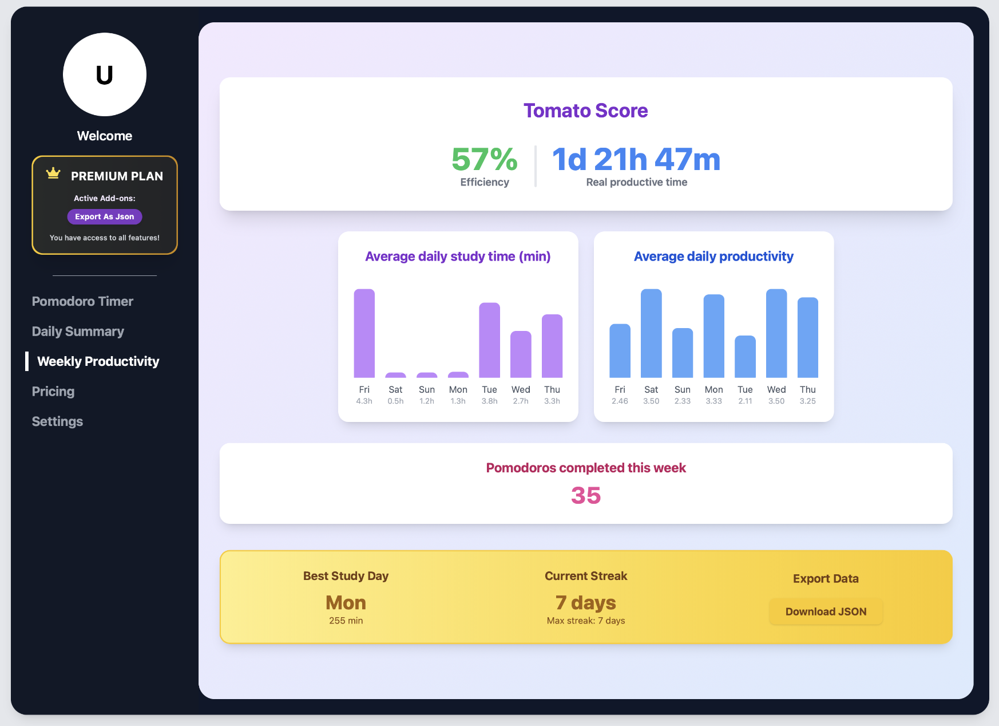
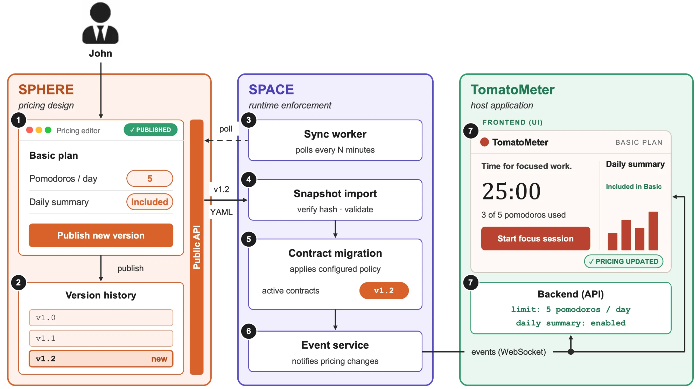
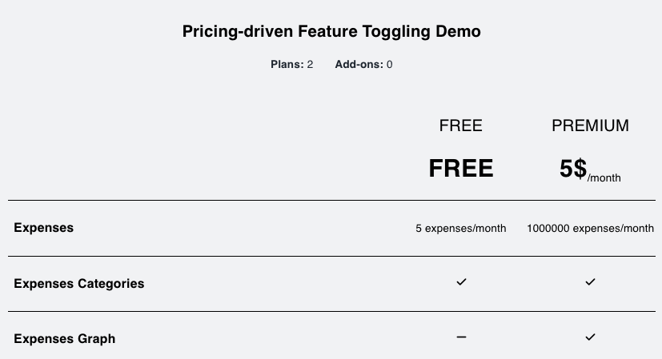

# TomatoMeter



TomatoMeter is a Pomodoro productivity app whose behavior is driven by its pricing. This repository packages it together with [SPHERE](https://github.com/SCORELabUS/sphere) and [SPACE](https://github.com/SCORELabUS/space) in a reproducible lab that demonstrates the full *No-code Pricing-Driven Self-adaptation* cycle: a pricing is designed and published in SPHERE, operated at runtime by SPACE, and enforced by TomatoMeter without redeploying the application.

The repository is also the hands-on material of the **ICSOC 2026 tutorial on pricing-driven self-adaptation**. It offers two ways to start the lab:

- **Demo** (`npm run demo`): TomatoMeter fully integrated with SPHERE and SPACE, ready to show the whole cycle.
- **Tutorial** (`npm run tutorial:1|2|3`): a TomatoMeter starter with no SPACE integration, in development mode, for attendees to connect it themselves. See the [tutorial guide](tutorial/README.md).

Developed by the [SCORE Lab](https://github.com/SCORELabUS), this project is part of ongoing research into pricing-driven development and operation.

▶️ **Watch the demo video:** [https://youtu.be/tQYkeKHu9qo](https://youtu.be/tQYkeKHu9qo)

## Table of Contents

1. [Quick Start](#quick-start)
   - [ICSOC 2026 tutorial](tutorial/README.md)
2. [How It Works](#how-it-works)
3. [Lab Internals](#lab-internals)
4. [About TomatoMeter and its Pricing](#about-tomatometer-and-its-pricing)
5. [Project Structure](#project-structure)
6. [Tech Stack](#tech-stack)
7. [Disclaimer & License](#disclaimer--license)

---

## Quick Start

### Prerequisites

- [Docker](https://www.docker.com/get-started) (Desktop or Engine) with Docker Compose.
- Node.js with npm, only to run the lab scripts.
> [!NOTE]
> We recommed using pnpm as the package manager, but npm works too.
- Ports `5401`, `5402` and `5403` free on your machine.

### Start the demo

```bash
git clone https://github.com/SCORELabUS/TomatoMeter.git
cd TomatoMeter
npm run demo
```

The first run downloads the SPHERE and SPACE images and builds TomatoMeter, so it takes a few minutes. The command returns when the lab is ready and prints the URLs below.

To follow the tutorial instead, see the [tutorial guide](tutorial/README.md).

### Services

Once the bootstrap finishes, you can access the three services in your browser:

| Service | Role | URL |
|---------|------|-----|
| **TomatoMeter** | The SaaS application whose features depend on the pricing | [http://localhost:5401](http://localhost:5401) |
| **SPHERE** | Pricing design and publication | [http://localhost:5402](http://localhost:5402) |
| **SPACE** | Runtime pricing enforcement | [http://localhost:5403](http://localhost:5403) |

### Credentials

SPHERE and SPACE share the same demo account:

| Username | Password |
|----------|----------|
| `tomato_demo` | `tomato-demo` |

TomatoMeter needs no login.

### Stop and reset

To stop the lab and delete all its data, run the following command in the project root:

```bash
npm run down
```

Starting the demo or any tutorial checkpoint also resets SPHERE and SPACE first, so every run starts from a known state.

## How It Works



The figure follows a running example: John, a stakeholder, changes the Basic plan so that it allows **5 pomodoros per day** (instead of 3) and **includes the Daily summary**. The workflow has seven steps. John performs the first two in SPHERE; SPACE and TomatoMeter carry out the other five automatically.

**Pricing design and release (SPHERE)**

1. **Pricing editor.** John edits the TomatoMeter pricing in SPHERE, either visually or by modifying its YAML directly.
2. **Version history.** John publishes the changes as a new version (`v1.2`), which is stored next to the previous ones. SPHERE exposes every published version through a read-only **public API** behind the pricing's permanent link (`/p/{pricingId}`). The API returns a manifest of versions, each with a release date and a content hash, and lets clients download the YAML of any version.

**Runtime enforcement (SPACE)**

3. **Sync worker.** The `TomatoMeter` service in SPACE is *linked* to that permanent link instead of holding an uploaded pricing. A sync worker periodically polls the manifest (every minute in this lab; the SPACE default is five minutes) and selects the target version according to the synchronization policy. The lab uses `all_last`, which targets the latest published version.
4. **Snapshot import.** When a new target appears, SPACE downloads its YAML, checks that it matches the hash in the manifest, validates it, and stores it as an immutable version of the service.
5. **Contract migration.** SPACE migrates the active contracts to `v1.2`. It keeps their plan, add-ons, billing dates and usage whenever they are still valid, and it falls back to the cheapest valid plan otherwise. If any contract cannot be migrated, none is, and every migration is recorded in the contract history.
6. **Event service.** SPACE invalidates its cached pricings, contracts and feature evaluations, then broadcasts a *pricing activated* event over WebSockets.

**Adaptation (TomatoMeter)**

7. **Frontend and backend.** Both sides of TomatoMeter listen to these events through the SPACE SDKs. The frontend re-renders its components (the Daily summary unlocks and the counter now reads *3 of 5 pomodoros used*). The backend enforces the new business rules (`limit: 5 pomodoros / day`, `daily summary: enabled`). No code change or redeployment is involved.

> [!NOTE]
> Linking SPACE to SPHERE is a one-time configuration, and the lab bootstrap does it for you. From then on, SPHERE is the only source of truth: SPACE rejects manual uploads to a linked service, so make every pricing change in SPHERE.

## Try it yourself

Prefer to watch first? The [demo video](https://youtu.be/tQYkeKHu9qo) shows the lab in action.

Reproduce the example from the figure in the running lab:

1. **Check the starting point.** Open TomatoMeter at [http://localhost:5401](http://localhost:5401). The demo user is on the Basic plan: 3 pomodoros per day and no Daily summary. Start pomodoros until the limit blocks you.
2. **Edit the pricing (step 1).** Log in to SPHERE at [http://localhost:5402](http://localhost:5402) as `tomato_demo` and open the TomatoMeter pricing in the editor. In the Basic plan, raise `maxPomodoroTimers` to `5` and enable `dailySummary`.
3. **Publish (step 2).** Publish the changes as a new public version.
4. **Watch SPACE work (steps 3–6).** Within a minute, SPACE detects the version, imports it and migrates the contract. To follow it, open the `TomatoMeter` service in SPACE at [http://localhost:5403](http://localhost:5403): it shows the synchronization status, the applied version and the number of migrated contracts.
5. **See TomatoMeter adapt (step 7).** Go back to TomatoMeter. Your usage is kept and the limit is now 5, so you can start another session. The Daily summary is also unlocked. If the page was in the background, refresh it.

You can repeat the cycle with any other change, such as removing a feature from a plan or lowering a limit, and see TomatoMeter apply the new restrictions.

## Lab Internals

The lab is a single Docker Compose project on a private network, started by [scripts/lab.mjs](scripts/lab.mjs). SPHERE and SPACE are defined in [infra/compose.base.yml](infra/compose.base.yml); TomatoMeter comes from an overlay: [infra/compose.demo.yml](infra/compose.demo.yml) builds the demo, and [infra/compose.tutorial.yml](infra/compose.tutorial.yml) runs the tutorial starter in development mode. Each application sits behind its own nginx proxy or dev server, which is the only container that publishes a port.

| Application | Containers | Image |
|-------------|------------|-------|
| SPHERE | `sphere-server`, `sphere-client`, `sphere-mongodb`, `sphere-redis`, `sphere-nginx` | `ghcr.io/scorelabus/sphere-{api,client}:2.6.0` |
| SPACE | `space-server`, `space-client`, `space-mongodb`, `space-redis`, `space-nginx`, `space-sphere-link` | `ghcr.io/scorelabus/space-{api,client}:1.7.0` |
| TomatoMeter (demo) | `tomatometer-server`, `tomatometer-client`, `tomatometer-nginx` | Built from [demo/](demo) |
| TomatoMeter (tutorial) | `tomatometer` (Vite + API in watch mode) | [tutorial/tomatometer](tutorial/tomatometer), mounted from your disk |

SPHERE and SPACE come as public images, so you do not need their repositories. To use other versions, set `SPHERE_VERSION` and `SPACE_VERSION` before starting the lab. SPACE links services to SPHERE with the same permanent links that the SPHERE UI copies (`http://localhost:5402/p/{pricingId}`). Inside the lab, the `space-sphere-link` proxy shares the SPACE container's network and forwards its `localhost:5402` to SPHERE, so those links work from SPACE too.

### Provisioning

A one-shot `lab-bootstrap` service ([infra/bootstrap/bootstrap.mjs](infra/bootstrap/bootstrap.mjs)) provisions SPHERE and SPACE up to a stage chosen by the launcher. Each stage includes the previous ones:

| Stage | Used by | Provisions |
|-------|---------|------------|
| `empty` | Tutorial checkpoint 1 | The `tomato_demo` user in SPHERE (verified by `verify-sphere-demo-user`) and in SPACE, with its default `TomatoMeter Lab` organization. |
| `pricing` | Tutorial checkpoint 2 | + The reference pricing ([demo/api/resources/TomatoMeter.yml](demo/api/resources/TomatoMeter.yml)) published in SPHERE. |
| `linked` | Tutorial checkpoint 3 | + The SPACE `TomatoMeter` service linked to that pricing with the `all_last` policy, and the organization API key written to `tutorial/tomatometer/.env`. |
| `demo` | Demo | + The contracts used by the demo interface, and the SPACE configuration handed to the TomatoMeter server. |

TomatoMeter starts only after the bootstrap finishes successfully.

## About TomatoMeter and its Pricing

TomatoMeter is a productivity management app based on the Pomodoro technique. It allows users to track their work sessions, evaluate their productivity, and review insights about their performance.

### Pricing

The reference pricing ([demo/api/resources/TomatoMeter.yml](demo/api/resources/TomatoMeter.yml)) defines three plans (BASIC, ADVANCED, and PREMIUM) and two add-ons (*Extra Timers* and *Export as JSON*).

**Features:**

- **Pomodoro Timer:** A timer to manage work sessions based on the Pomodoro technique, subject to a daily **usage limit** (`maxPomodoroTimers`) on the number of timers that can be started.
- **Sound Notifications:** Sound notifications that signal the end of each pomodoro.
- **Basic Analytics:** Number of completed pomodoros, total time worked, and productivity score.
- **Motivational Quotes:** Motivational quotes shown above the timer.
- **Daily Summary:** Overview of completed pomodoros by day over the last month.
- **Dark Mode:** A dark color scheme for low-light environments.
- **Custom Pomodoro Duration:** Custom durations for pomodoros and breaks.
- **Advanced Analytics:** Productivity trends, pomodoro streaks, and more.
- **Export Data as JSON:** Export pomodoro data in JSON format for further analysis or backup.

The pricing page (see image below) shows which features are enabled or disabled for each subscription (i.e., the selected plan and, optionally, contracted add-ons).



## Project Structure

```
.
├── package.json          # Lab commands: demo, tutorial:1|2|3, down
├── scripts/lab.mjs       # Launcher used by those commands
├── infra/                # Docker Compose files, bootstrap, nginx and MongoDB setup
├── demo/                 # TomatoMeter fully integrated with SPACE
│   ├── api/              # Backend (Express, TypeScript); resources/ holds the reference pricing
│   ├── src/              # Frontend (React, Vite, TypeScript)
│   ├── docker/           # Images used by the demo
│   └── tests/            # Subscription synchronization tests
├── tutorial/             # ICSOC 2026 tutorial
│   ├── README.md         # Step-by-step guide for attendees
│   ├── target-pricing.png# Pricing to design during the tutorial
│   ├── tomatometer/      # Starter app, with the TODOs to connect it to SPACE
│   └── solution/         # The starter files that change, already solved
├── images/               # Screenshots used in this README
└── README.md             # This file
```

---

## Tech Stack

<div align="center">

| Frontend         | Backend         | Tooling & DevOps      | Other                |
|------------------|----------------|-----------------------|----------------------|
|  |  |  |  |
|  |  |  |  |
|  |  |  |  |

</div>

---

## Disclaimer & License

> **License:**
> This project is licensed under the MIT License. See the [LICENSE](LICENSE) file for details.

> **Disclaimer:**
> This repository is developed and maintained in a controlled research environment by the [SCORE Lab](https://score.us.es) to demonstrate advances in pricing-driven self-adaptation solutions.
> The SCORE Lab is not responsible for any issues, damages, or consequences that may arise if this software is used in other projects or production environments.
> Use at your own risk.

If you have any questions or want to contribute, feel free to open an issue or contact the maintainers.
