# TomatoMeter Lab Manual

**ICSOC 2026 Tutorial · Pricing-driven Self-adaptation**

In this lab you take **TomatoMeter**, a Pomodoro app that knows nothing about pricing, and make it *pricing-driven*. You will:

1. **Design** TomatoMeter's pricing from scratch in **SPHERE** and publish it.
2. **Operate** that pricing at runtime with **SPACE**, linked to SPHERE.
3. **Connect** TomatoMeter to SPACE with a handful of code changes, so it enforces the pricing.
4. **Change** the pricing in SPHERE and watch TomatoMeter adapt by itself: no code change, no redeploy.


Follow the parts in order. Each part ends with a **✅ Check** telling you what you should see before moving on. If you fall behind, a **⏩ Catch up** box shows how to jump to the next part with everything already set up.

## Contents

- [Part 0 · Set up the lab](#part-0--set-up-the-lab)
- [Part 1 · Design the pricing in SPHERE](#part-1--design-the-pricing-in-sphere)
- [Part 2 · Operate the pricing with SPACE](#part-2--operate-the-pricing-with-space)
- [Part 3 · Connect TomatoMeter to SPACE](#part-3--connect-tomatometer-to-space)
- [Part 4 · Change the pricing and watch TomatoMeter adapt](#part-4--change-the-pricing-and-watch-tomatometer-adapt)
- [Wrap-up](#wrap-up)
- [Troubleshooting](#troubleshooting)

---

## Part 0 · Set up the lab

### 0.1 Requirements

- **Docker** (Desktop or Engine) with Docker Compose, **running**.
- **Node.js** with npm.
- **Git** and a code editor (VS Code or similar).
- Ports `5401`, `5402` and `5403` free.

### 0.2 Get the code and start the lab

```bash
git clone https://github.com/SCORELabUS/TomatoMeter.git
```

```bash
cd TomatoMeter
```

```bash
npm run tutorial:1
```

The first start downloads several images and installs TomatoMeter's dependencies, so it can take a few minutes. When it is ready, the terminal prints:

```text
Laboratory ready (stage: empty): SPHERE and SPACE only contain the tomato_demo user.

  TomatoMeter  http://localhost:5401  (dev mode: edits in tutorial/tomatometer reload automatically)
  SPHERE       http://localhost:5402
  SPACE        http://localhost:5403
  Credentials  tomato_demo / tomato-demo  (SPHERE and SPACE)
```

The terminal then keeps showing TomatoMeter's logs (`[api]` for the backend, `[web]` for the frontend). Leave it open: you will look at it later. Press `Ctrl+C` only if you want to stop following the logs; the lab keeps running.

> [!TIP]
> Optional: for autocompletion in your editor, run `npm install` inside `tutorial/tomatometer`. TomatoMeter itself runs inside Docker and does not need it.

### 0.3 Take a look at TomatoMeter

Open [http://localhost:5401](http://localhost:5401). This is the **starter**: it has no pricing at all, so every page is open to everyone. Go to **Daily Summary**: anyone can see it.

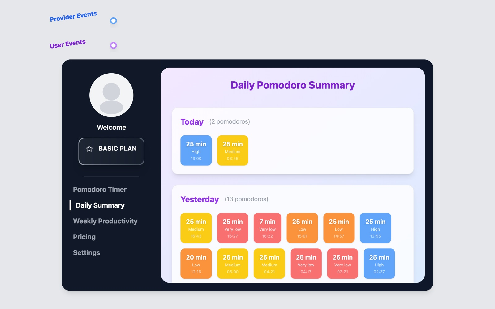

Now open **Pricing**. TomatoMeter tells you it is not connected to SPACE. That is what you will fix.

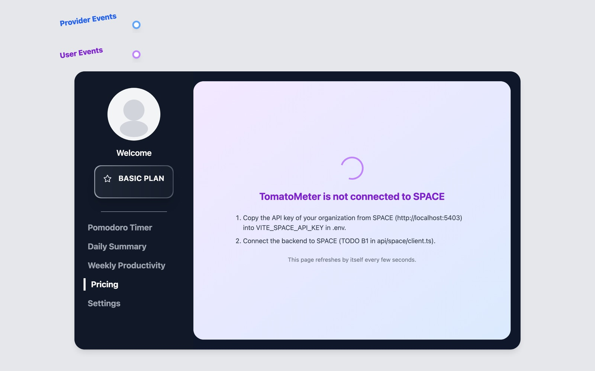

The code you will edit lives in `tutorial/tomatometer`. Open that folder in your editor.

### ✅ Check

- TomatoMeter, SPHERE and SPACE open in your browser.
- The Pricing page says *"TomatoMeter is not connected to SPACE"*.

---

## Part 1 · Design the pricing in SPHERE

Your goal is this pricing: three plans, a daily limit of pomodoros and two add-ons.


> [!IMPORTANT]
> TomatoMeter's code refers to the pricing by name. Keep the names exactly as in the YAML blocks below: the SaaS name `TomatoMeter`, the plans `basic`, `advanced` and `premium`, the features (`pomodoroTimer`, `dailySummary`…) and the usage limit `maxPomodoroTimers`.

### 1.1 Log in

Open SPHERE at [http://localhost:5402](http://localhost:5402), click **LOGIN** and sign in as `tomato_demo` / `tomato-demo`.

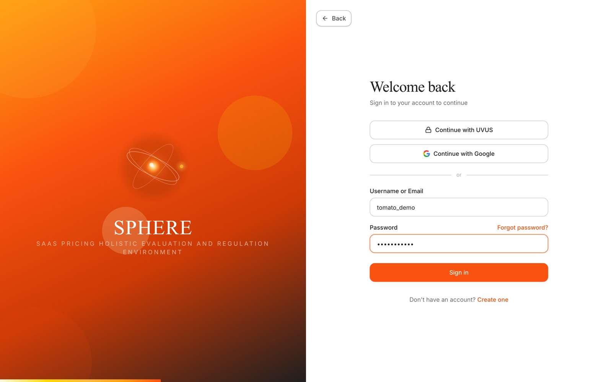

### 1.2 Open the Pricing Editor

On your workspace, click **Pricing Editor** under *Quick Actions*.

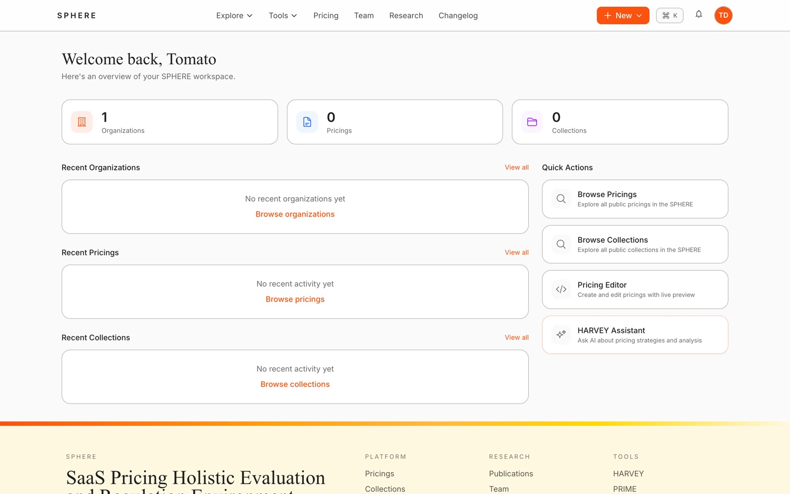

In **Code** mode, the editor shows the YAML on the left and a live preview of the pricing on the right. It opens with an example pricing (PetClinic).

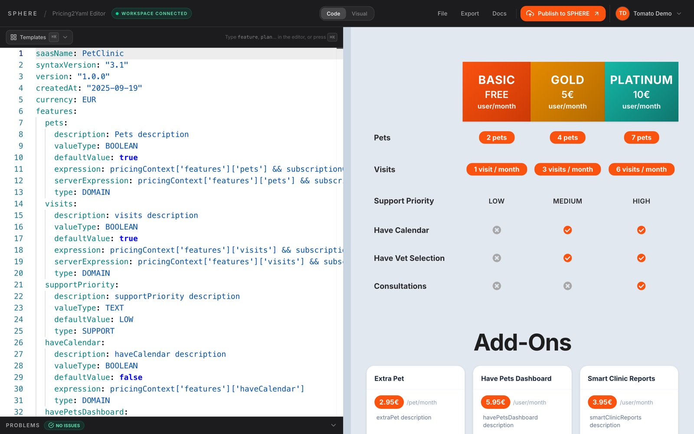

Click **File → Clear** to start from an empty document.

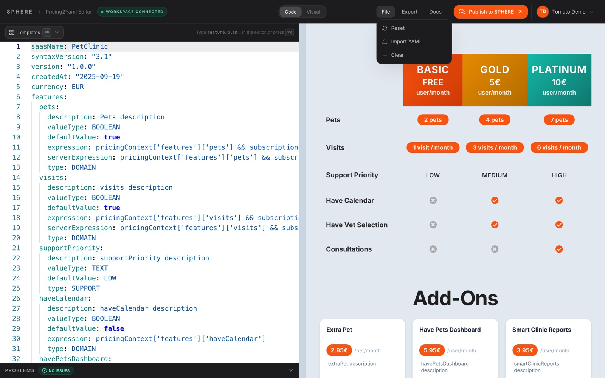

The editor has two modes, switched at the top: **Code**, where you write the YAML, and **Visual**, where you edit the pricing as a table. You will use both.

### 1.3 Declare the building blocks

Paste the following YAML into the empty editor. It declares everything your plans are built from: the SaaS, its **nine features**, the daily **usage limit** `maxPomodoroTimers`, the **three plans** with their prices (still empty), and the **two add-ons**.

> [!NOTE]
> We declare these building blocks in code only to save time during the session. Everything can also be created from the **Visual** editor, which has buttons to add features (**ADD FEATURE**), usage limits (**ADD USAGE LIMIT**) and plans (**+**).

```yaml
saasName: TomatoMeter
syntaxVersion: "3.1"
version: "1.0.0"
createdAt: "2026-10-14"
currency: USD
features:
  pomodoroTimer:
    description: Start pomodoro timers
    valueType: BOOLEAN
    defaultValue: true
    expression: pricingContext['features']['pomodoroTimer'] && subscriptionContext['maxPomodoroTimers'] < pricingContext['usageLimits']['maxPomodoroTimers']
    type: DOMAIN
  soundNotifications:
    description: Ring a sound every time a timer finishes or is stopped
    valueType: BOOLEAN
    defaultValue: true
    expression: pricingContext['features']['soundNotifications']
    type: AUTOMATION
    automationType: TRACKING
  basicAnalytics:
    description: Weekly productivity analytics, such as the Tomato Score
    valueType: BOOLEAN
    defaultValue: true
    expression: pricingContext['features']['basicAnalytics']
    type: INFORMATION
  motivationalQuotes:
    description: Show a motivational quote above the timer
    valueType: BOOLEAN
    defaultValue: false
    expression: pricingContext['features']['motivationalQuotes']
    type: DOMAIN
  dailySummary:
    description: Overview of completed pomodoros by day over the last month
    valueType: BOOLEAN
    defaultValue: false
    expression: pricingContext['features']['dailySummary']
    type: INFORMATION
  darkMode:
    description: A dark color scheme for low-light environments
    valueType: BOOLEAN
    defaultValue: false
    expression: pricingContext['features']['darkMode']
    type: DOMAIN
  customPomodoroDuration:
    description: Custom durations for pomodoros and breaks
    valueType: BOOLEAN
    defaultValue: false
    expression: pricingContext['features']['customPomodoroDuration']
    type: DOMAIN
  advancedAnalytics:
    description: Productivity trends, pomodoro streaks and more
    valueType: BOOLEAN
    defaultValue: false
    expression: pricingContext['features']['advancedAnalytics']
    type: INFORMATION
  exportDataToJson:
    description: Export pomodoro data as JSON
    valueType: BOOLEAN
    defaultValue: false
    expression: pricingContext['features']['exportDataToJson']
    type: DOMAIN
usageLimits:
  maxPomodoroTimers:
    description: Maximum number of pomodoro timers per day
    valueType: NUMERIC
    defaultValue: 3
    unit: timer
    type: RENEWABLE
    period:
      unit: DAY
      value: 1
    linkedFeatures:
      - pomodoroTimer
plans:
  basic:
    description: Basic plan
    price: 0.0
    unit: user/month
    features: null
  advanced:
    description: Advanced plan
    price: 3.99
    unit: user/month
    features: null
  premium:
    description: Premium plan
    price: 9.99
    unit: user/month
    features: null
addOns:
  extraTimers:
    description: 5 extra pomodoro timers per day for each unit
    price: 1.00
    unit: month
    usageLimitsExtensions:
      maxPomodoroTimers:
        value: 5
  exportAsJson:
    description: Export your pomodoro data as JSON
    availableFor:
      - premium
    price: 2.00
    unit: month
    features:
      exportDataToJson:
        value: true
```

The preview on the right shows the three plans:

- **Pomodoro Timer shows 3 timers / day** in every plan. The usage limit `maxPomodoroTimers` (`defaultValue: 3`) is linked to the feature `pomodoroTimer` through `linkedFeatures`. Features and usage limits are written in camelCase in the YAML.
- **Features with `defaultValue: true` show a check in every plan**, even though no plan declares them yet: a plan inherits the `defaultValue` of every feature it does not declare.

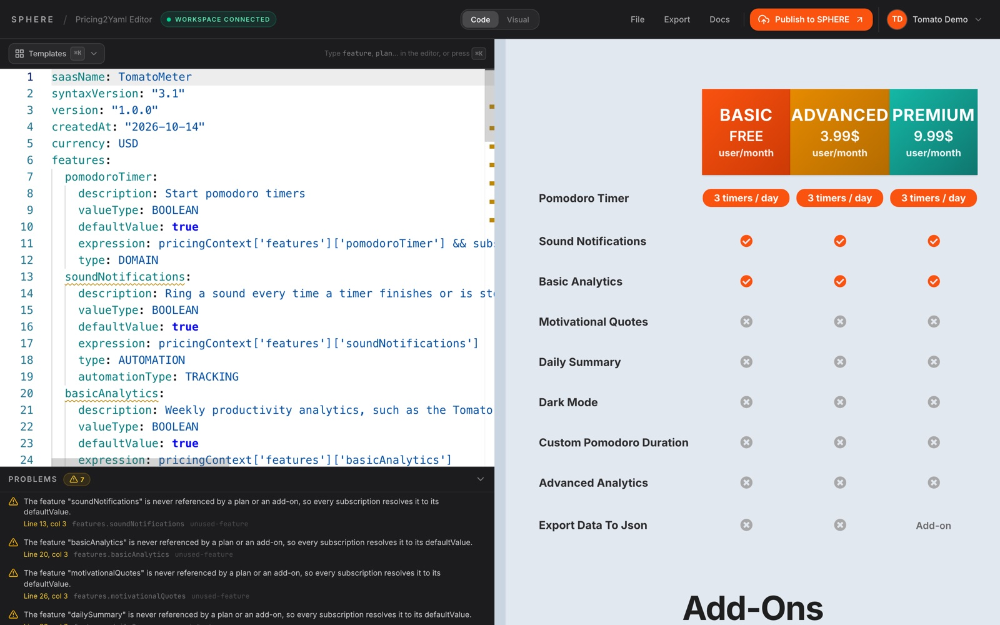

The **Problems** panel shows warnings: **they are normal**. No plan overwrites the value of any of these features yet, so every plan is asigned with their `defaultValue`. What matters is that there are **no errors** (red icons).

### 1.4 Design the plans in the Visual editor

From now on, you make every change in the **Visual** editor. Click **Visual** at the top of the editor. You see the pricing as a table: plans in the columns, features and usage limits in the rows.


**Choose what each plan includes.** Click a cell to switch a feature on (orange check) or off (grey cross) in that plan:

| Feature | ADVANCED | PREMIUM |
|---------|:--------:|:-------:|
| Motivational Quotes | ✔ | ✔ |
| Daily Summary | ✔ | ✔ |
| Dark Mode | ✔ | ✔ |
| Custom Pomodoro Duration | | ✔ |
| Advanced Analytics | | ✔ |

Leave BASIC as it is, and leave *Export Data To Json* off everywhere: it comes with an add-on.

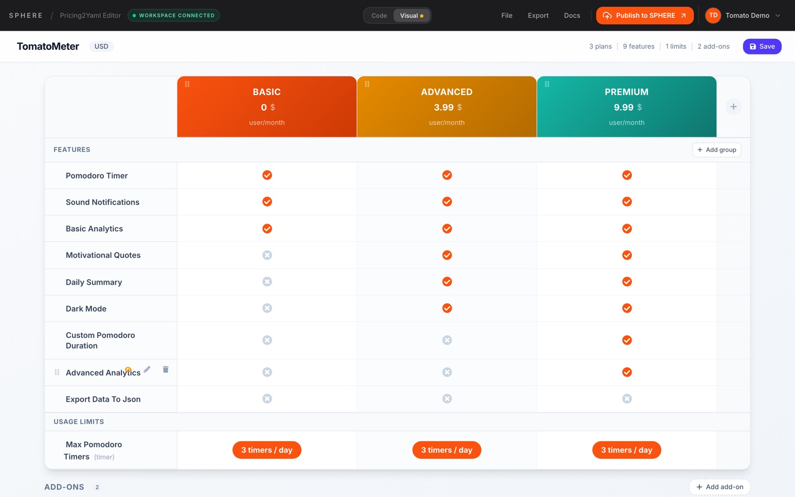

**Set the daily limits.** In the *Max Pomodoro Timers* row, click **3 timers / day** under ADVANCED, type `10` and press **Enter**. Do the same under PREMIUM with `15`.

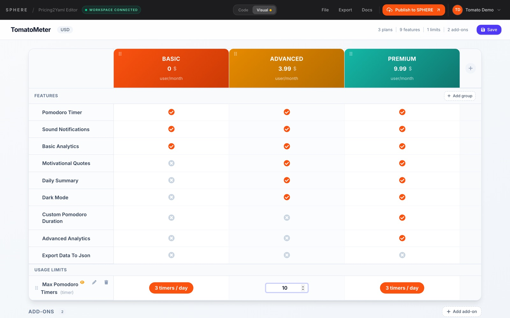

**Save.** Click **Save** at the top right to apply your changes to the pricing. The orange dot next to *Visual* disappears.

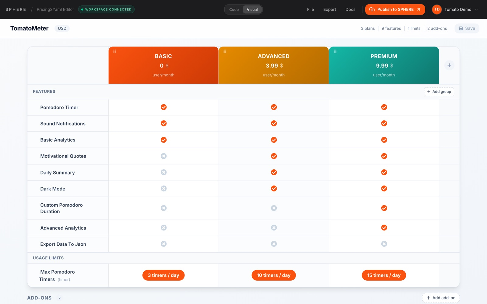

Scroll down to see the two add-ons you declared. *Export As Json* is only available for **premium** and unlocks *Export Data To Json*.

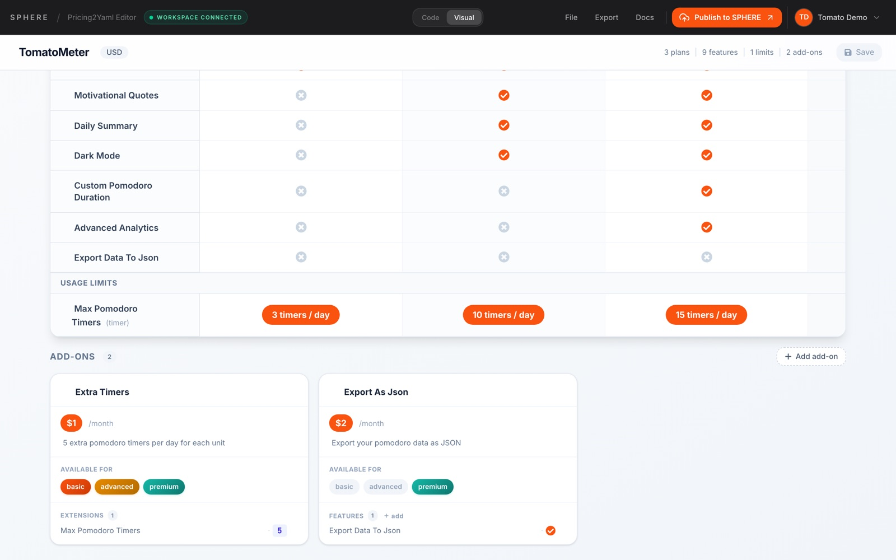

The pricing now matches the [target pricing](../demo/api/resources/TomatoMeter.yml).

> [!TIP]
> Want to see what the Visual editor wrote? Switch to **Code**: the `plans` section now lists the features and limits of each plan.

### 1.5 Publish it

Click **Publish to SPHERE** and fill in the dialog:

- **New pricing**.
- **Organization**: `tomato_demo PERSONAL`.
- **Pricing name**: `TomatoMeter`.
- **Visibility**: **Public**. SPACE can only synchronize public versions.

Click **Publish**.

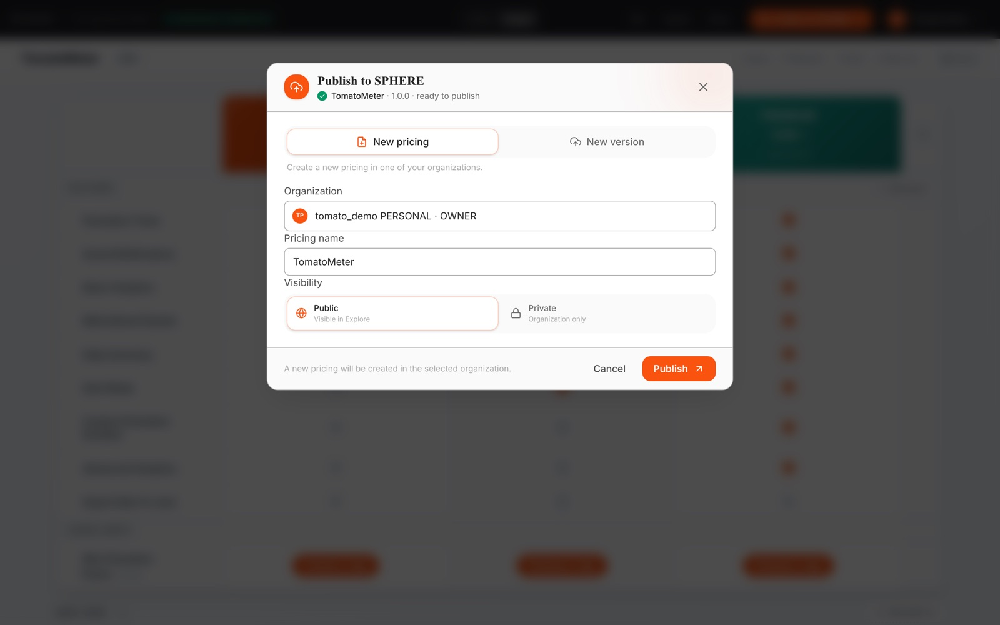

SPHERE opens the page of your pricing, version **1.0.0**.

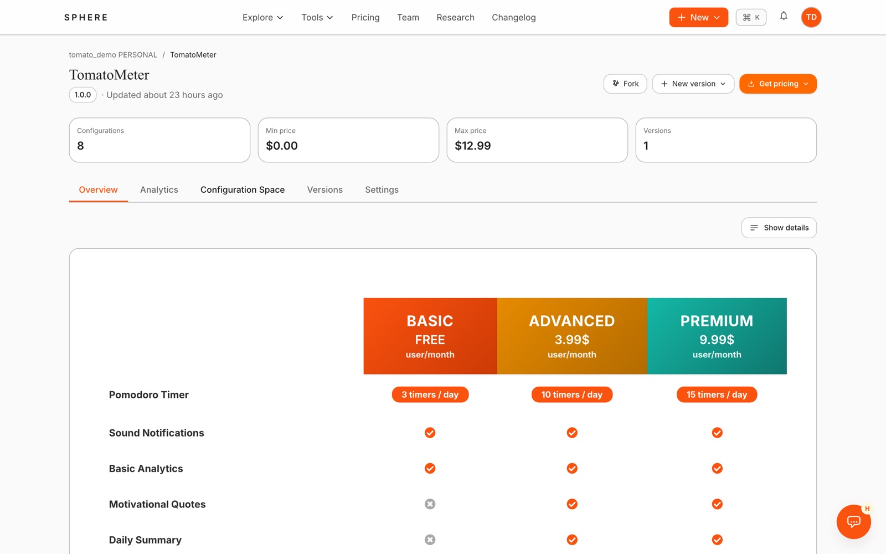

### 1.6 Copy the permanent link

Click **Get pricing** and copy the **Permanent link** with the copy button. It looks like `http://localhost:5402/p/6ad0…`. This link always points to the pricing, whatever versions you publish later. You need it in Part 2.

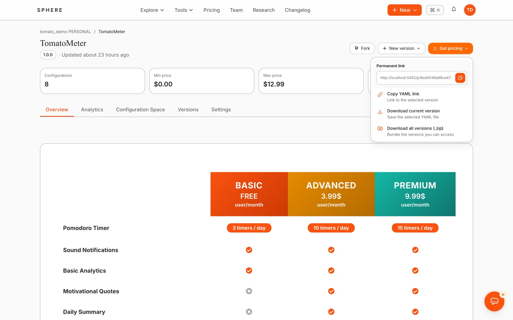

### ✅ Check

- Your TomatoMeter pricing, version 1.0.0, is published and public in SPHERE.
- You have its permanent link.

> [!NOTE]
> **⏩ Catch up.** To start Part 2 with the pricing already published, run `npm run tutorial:2`. It resets SPHERE and SPACE. Then copy the permanent link as in step 1.6: log in to SPHERE, open **Browse Pricings → TomatoMeter** and use **Get pricing**.

---

## Part 2 · Operate the pricing with SPACE

### 2.1 Log in

Open SPACE at [http://localhost:5403](http://localhost:5403) and log in as `tomato_demo` / `tomato-demo`.

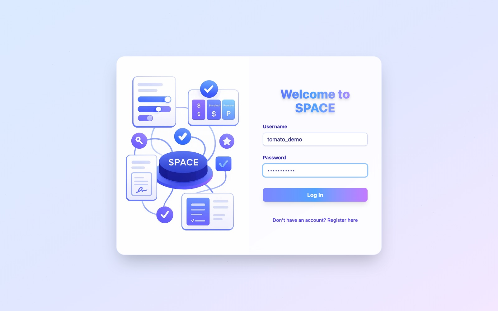

Your organization, **TomatoMeter Lab**, is already there, with no services yet.

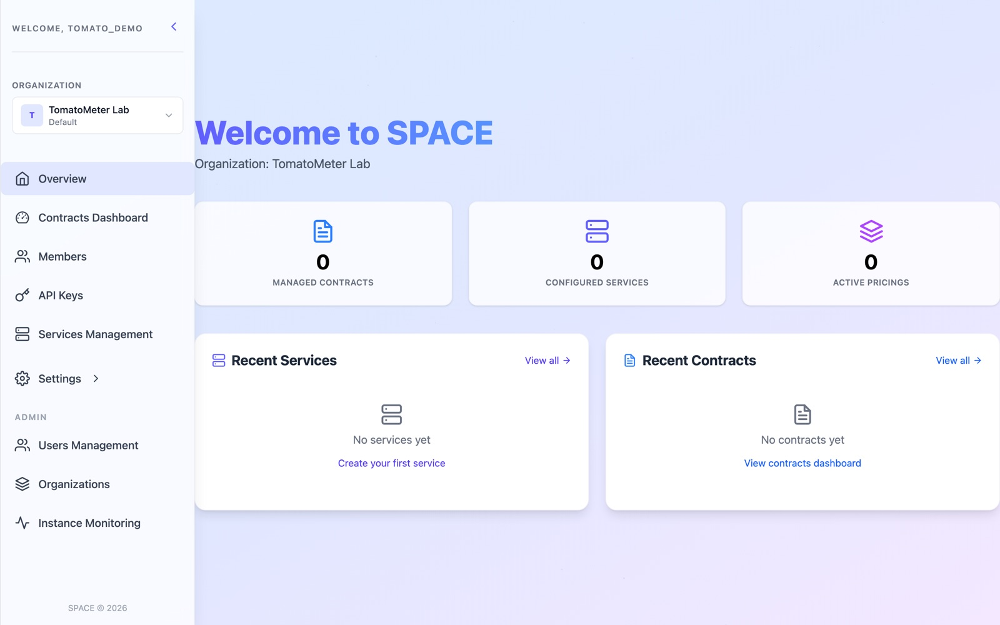

### 2.2 Link the TomatoMeter service to SPHERE

Go to **Services Management** and click **Add Service**.

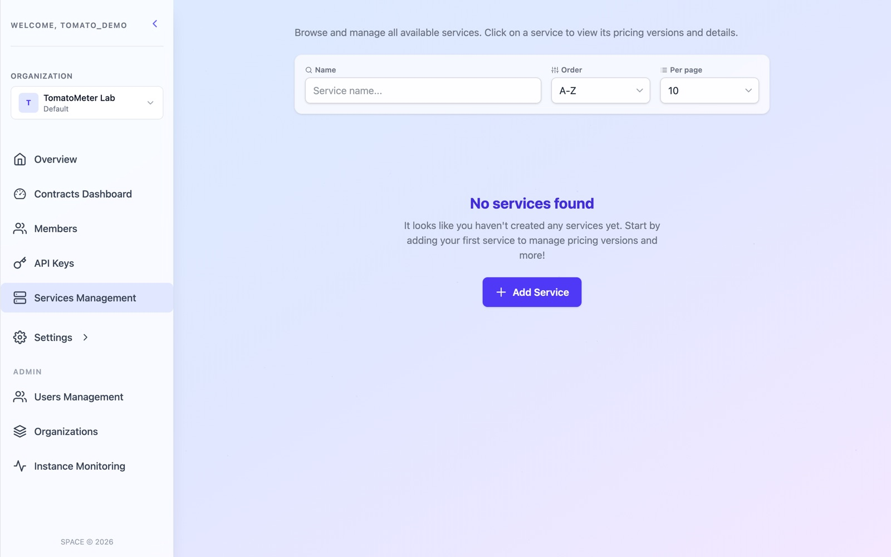

Fill in the dialog:

1. **Pricing source**: **Link to SPHERE**.
2. **SPHERE permanent link**: paste the link from step 1.6, then click **Check pricing and versions**. SPACE finds *TomatoMeter · 1 public versions*.
3. **Synchronization policy**: **All last version**. Every contract always follows the latest published version.
4. **Check for new versions**: **Every minute**.
5. Click **Link service**.

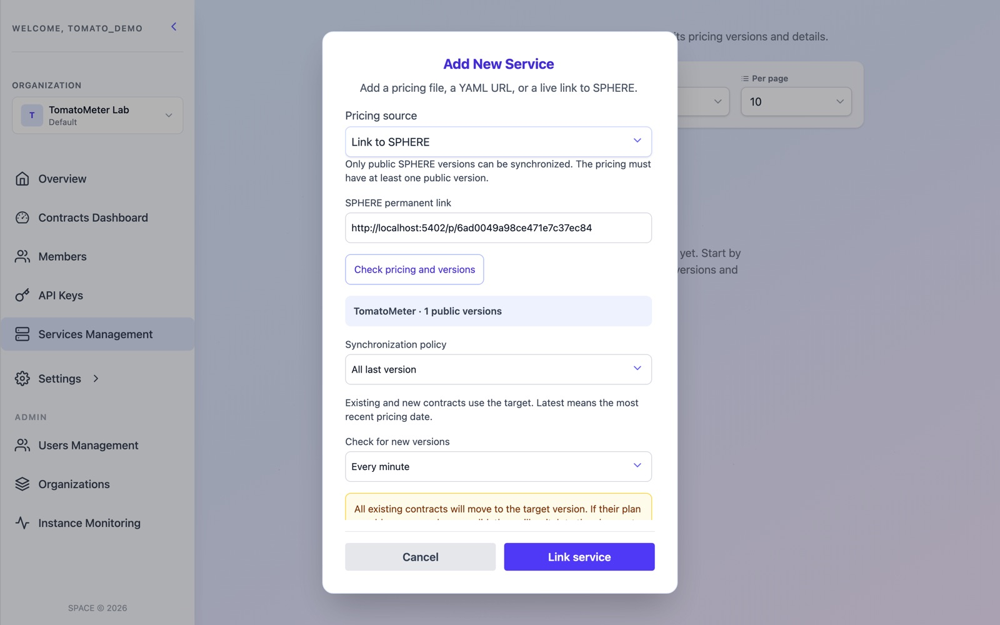

Open the new **tomatometer** service. SPACE shows it is connected to SPHERE and applies version **v1.0.0**.

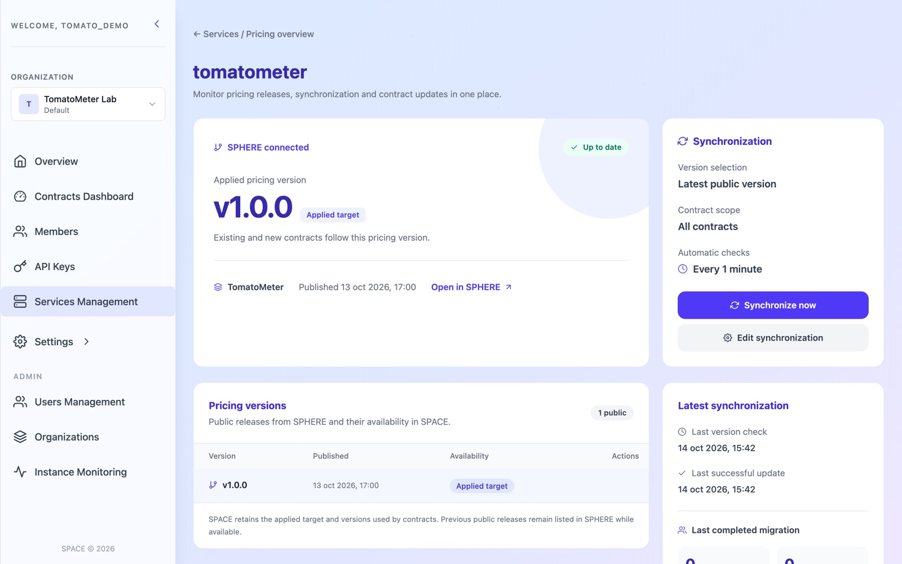

### 2.3 Give TomatoMeter access to SPACE

Go to **API Keys** and copy the organization key with the copy button.

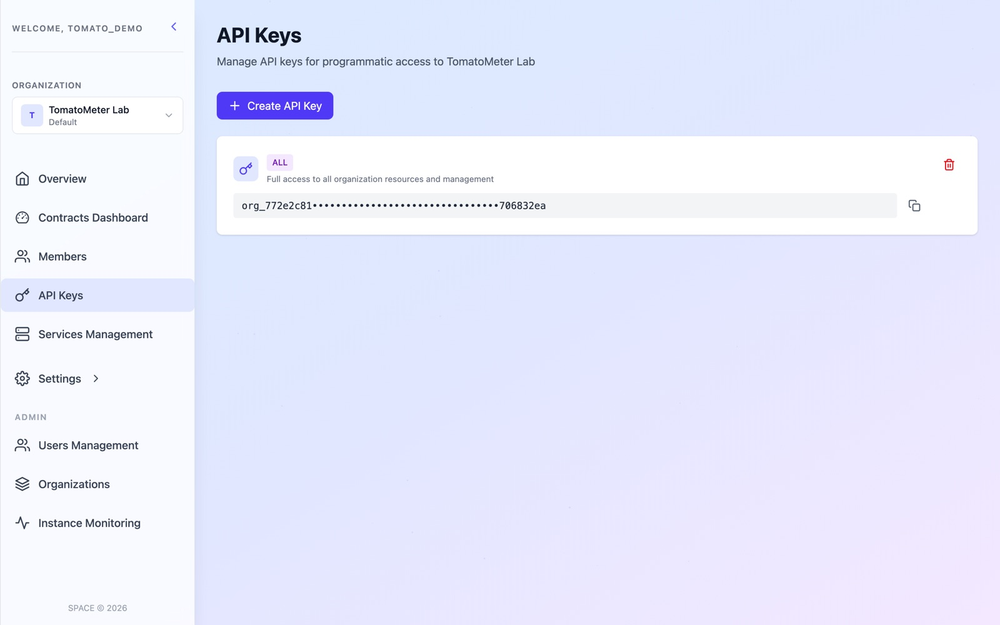

Open `tutorial/tomatometer/.env` in your editor and paste it:

```dotenv
VITE_SPACE_API_KEY=org_…
```

Save the file. TomatoMeter reloads by itself; there is nothing to restart.

> [!WARNING]
> It's normal that TomatoMeter's Pricing page still says it is not connected. The code does not "talk" to SPACE yet.

### ✅ Check

- SPACE has a **tomatometer** service linked to SPHERE, applying v1.0.0.
- `tutorial/tomatometer/.env` contains your API key.

> [!NOTE]
> **⏩ Catch up.** To start Part 3 with SPHERE and SPACE already set up, run `npm run tutorial:3`. The service is linked and the API key is already in `.env`.

---

## Part 3 · Connect TomatoMeter to SPACE

Everything TomatoMeter needs is already in place: the screens for locked features, the Pricing page, and the creation of a contract in SPACE for the demo user (`test-user-id`) on the cheapest plan. You only write the **integration**, at the places marked with `TODO` in the code.

Two ideas help you through this part:

- **Feature ids** are `<saas name in lowercase>-<feature name>`: `tomatometer-pomodoroTimer`, `tomatometer-dailySummary`, `tomatometer-maxPomodoroTimers`…
- The frontend never asks SPACE about each feature. It loads a **pricing token**: a signed snapshot with the evaluation of every feature for the user. The `<Feature>` component reads it and re-renders whenever the token changes.

Every time you save a file, TomatoMeter reloads. Keep the terminal with the logs in view.

These are the TODOs, in the order this part follows:

| TODO | File | What to do |
|------|------|------------|
| **B1** | [api/space/client.ts](tomatometer/api/space/client.ts) | Connect the backend to SPACE with `space-node-client`. |
| **F1** | [src/App.tsx](tomatometer/src/App.tsx) | Wrap the app in `<SpaceProvider>` from `space-react-client`. |
| **F2** | [src/contexts/subscriptionContext/index.tsx](tomatometer/src/contexts/subscriptionContext/index.tsx) | Load the user's pricing token with `spaceClient.setUserId(...)`. |
| **F3** | [src/contexts/subscriptionContext/index.tsx](tomatometer/src/contexts/subscriptionContext/index.tsx) | Listen to `pricing_actived` and refresh the subscription. |
| **B2** | [api/routes/pomodoro.ts](tomatometer/api/routes/pomodoro.ts) | Before saving a pomodoro, evaluate `tomatometer-pomodoroTimer` while consuming one `tomatometer-maxPomodoroTimers`; reply 403 if it is not allowed. |
| **F4** | [src/pages/pomodoro-timer/pomodoro-timer.tsx](tomatometer/src/pages/pomodoro-timer/pomodoro-timer.tsx) | Show the timer controls only while pomodoros are left (`<Feature id="tomatometer-pomodoroTimer">`). |
| **F5** | [src/pages/daily-summary/daily-summary.tsx](tomatometer/src/pages/daily-summary/daily-summary.tsx) | Restrict the Daily summary to ADVANCED and PREMIUM (`<Feature id="tomatometer-dailySummary">`). |

> [!TIP]
> Each TODO has a solution below it, hidden in a collapsible block. Try first; open it if you get stuck. The full solution is also in [`tutorial/solution`](solution).

### B1 · Connect the backend to SPACE

**File:** `api/space/client.ts`

Create the SPACE client with `connect()` from `space-node-client`, using `SPACE_URL` and `SPACE_API_KEY`, and store it in `spaceClient`. When it emits `synchronized`, call `onSpaceReady(client)`, which is already implemented: it creates the demo user's contract.

<details>
<summary>Solution</summary>

```ts
  // --------------------------------------
  // TODO B1 · Connect the backend to SPACE
  // ...
  // --------------------------------------

  spaceClient = connect({ url: SPACE_URL, apiKey: SPACE_API_KEY });
  spaceClient.on('synchronized', () => {
    onSpaceReady(spaceClient!);
  });
```

</details>

**✅ Check.** The logs show:

```text
[api] Connected to Space WebSocket
[api] SPACE ready: 'test-user-id' subscribed to the 'basic' plan of TomatoMeter 1.0.0.
```

The Pricing page shows **your** pricing, and the sidebar shows the **BASIC PLAN**.

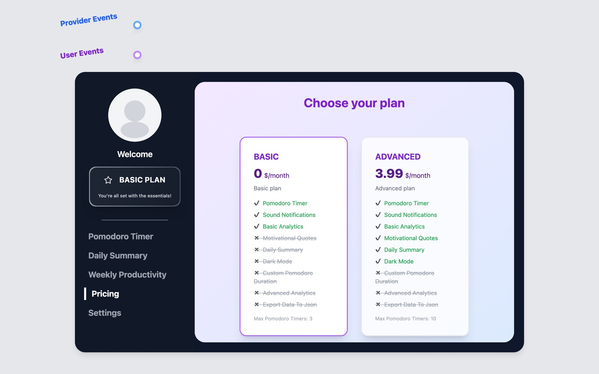

### F1 · Connect the frontend to SPACE

**File:** `src/App.tsx`

Wrap the whole tree returned by `App` in `<SpaceProvider config={spaceConfig}>`, imported from `space-react-client`. `spaceConfig` already reads the SPACE URL and API key from `.env`.

<details>
<summary>Solution</summary>

```tsx
// --------------------------------------
// F1 · Connect the frontend to SPACE
// ...
// --------------------------------------
return (
  <SpaceProvider config={spaceConfig}>
    <TimelineProvider>
      <div className="flex flex-col h-screen w-screen">
        <div className="flex flex-1">
          <PageProvider>
            <SettingsContext.Provider value={{ toggles, setToggles }}>
              <SubscriptionProvider>
                <DemoApp />
              </SubscriptionProvider>
            </SettingsContext.Provider>
          </PageProvider>
        </div>
      </div>
    </TimelineProvider>
  </SpaceProvider>
);
```

</details>

**✅ Check.** Nothing changes visually, and the app still works. Every SPACE hook and `<Feature>` component can now be used.

### F2 · Load the user's pricing token

**File:** `src/contexts/subscriptionContext/index.tsx` (two places)

1. Get the client with `useSpaceClient()`.
2. In `refresh()`, after the subscription is read, ask SPACE for the user's token with `spaceClient.setUserId(USER_ID)`.

`refresh()` already runs when the app loads, when the tab gets the focus back, after every pomodoro and after every plan change, so the token stays up to date.

<details>
<summary>Solution</summary>

```tsx
// --------------------------------------
// F2 · Load the user's pricing token (part 1 of 2)
// ...
// --------------------------------------
const spaceClient = useSpaceClient();
```

```tsx
// --------------------------------------
// F2 · Load the user's pricing token (part 2 of 2)
// ...
// --------------------------------------
await spaceClient.setUserId(USER_ID);
```

Add `spaceClient` to the dependencies of the `useCallback`, and import the hook:

```tsx
import { useSpaceClient } from 'space-react-client';
```

</details>

**✅ Check.** Nothing changes visually and the browser console (F12) shows no errors. You will see the token at work in F4 and F5, which use it.

> [!WARNING]
> `useSpaceClient()` only works inside `<SpaceProvider>`. If the page goes blank with *"useSpaceClient must be used within a SpaceProvider"*, finish F1 first.

### F3 · React to pricing changes

**File:** `src/contexts/subscriptionContext/index.tsx`

When SPACE activates a new pricing version, it emits a `pricing_actived` event. Add a `useEffect` that subscribes to it with `spaceClient.on('pricing_actived', …)`, calls `refresh()`, and unsubscribes with `spaceClient.off(…)` in its cleanup function.

<details>
<summary>Solution</summary>

```tsx
// --------------------------------------
// F3 · React to pricing changes
// ...
// --------------------------------------

useEffect(() => {
  const onPricingActivated = () => void refresh();
  spaceClient.on('pricing_actived', onPricingActivated);
  return () => spaceClient.off('pricing_actived', onPricingActivated);
}, [spaceClient, refresh]);
```

</details>

**✅ Check.** Nothing visible yet: you will see its effect in Part 4.

### B2 · Enforce the daily pomodoro limit on the server

**File:** `api/routes/pomodoro.ts`

Hiding a button is not enough: the backend must refuse the request too. Before saving a pomodoro session, confirm whether the user can do so by evaluating `tomatometer-pomodoroTimer`. If they can, **ensure to consume one unit** of `tomatometer-maxPomodoroTimers`. You can do both in one call to `spaceClient.features.evaluate()`:

```ts
spaceClient.features.evaluate(userId, featureId, { 'tomatometer-maxPomodoroTimers': 1 })
```

SPACE answers `{ eval, limit, used, error }`. If `eval` is `false`, reply with **403** and do not save the session.

<details>
<summary>Solution</summary>

```ts
// --------------------------------------
// B2 · Enforce the daily pomodoro limit on the server
// ...
// --------------------------------------
if (spaceClient) {
  try {
    const evaluation = await spaceClient.features.evaluate(
      userId,
      'tomatometer-pomodoroTimer',
      { 'tomatometer-maxPomodoroTimers': 1 },
      { server: true }
    );
    if (!evaluation.eval) {
      return res.status(403).json({ error: 'Daily pomodoro limit reached' });
    }
  } catch {
    return res.status(502).json({ error: 'Unable to evaluate the feature in SPACE' });
  }
}
```

</details>

### F4 · Show the timer controls only while pomodoros are left

**File:** `src/pages/pomodoro-timer/pomodoro-timer.tsx`

Wrap the timer controls (the `<div>` with *Start*, *Stop* and *Reset*) in `<Feature id="tomatometer-pomodoroTimer">`:

- `<On>`: the controls.
- `<Default>`: the ready-made `<PomodoroLimitReached />`.

<details>
<summary>Solution</summary>

```tsx
{/* F4 · Show the timer controls only while pomodoros are left today */}
<Feature id="tomatometer-pomodoroTimer">
  <On>
    <div className="flex gap-4">
      <motion.button
        whileTap={{ scale: 0.9 }}
        className="px-6 py-2 rounded-lg bg-purple-600 dark:bg-yellow-400 text-white dark:text-yellow-900 font-bold shadow-lg hover:bg-purple-700 dark:hover:bg-yellow-500 transition"
        onClick={startTimer}
        disabled={isRunning}
      >
        Start
      </motion.button>
      <motion.button
        whileTap={{ scale: 0.9 }}
        className="px-6 py-2 rounded-lg bg-red-500 dark:bg-yellow-600 text-white dark:text-yellow-100 font-bold shadow-lg hover:bg-red-600 dark:hover:bg-yellow-700 transition"
        onClick={stopTimer}
        disabled={!isRunning}
      >
        Stop
      </motion.button>
      <motion.button
        whileTap={{ scale: 0.9 }}
        className="px-6 py-2 rounded-lg bg-gray-400 dark:bg-gray-700 text-white dark:text-yellow-200 font-bold shadow-lg hover:bg-gray-500 dark:hover:bg-gray-600 transition"
        onClick={resetTimer}
      >
        Reset
      </motion.button>
    </div>
  </On>
  <Default>
    <PomodoroLimitReached />
  </Default>
</Feature>
```

Add `Default`, `Feature` and `On` to the imports from `space-react-client`.

</details>

**✅ Check B2 and F4.** Open **Pomodoro Timer** and run three pomodoros. To go fast, click **Start**, then **Stop**: it counts as one.

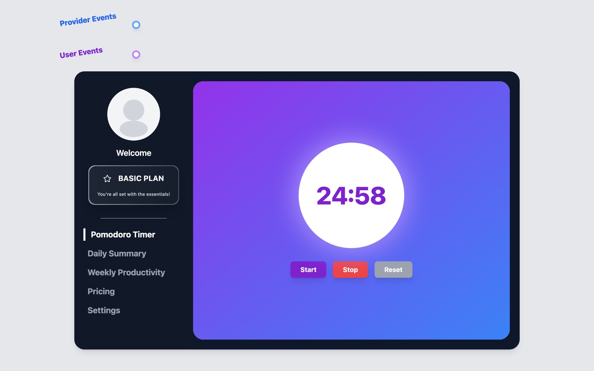

After each one, rate your productivity.

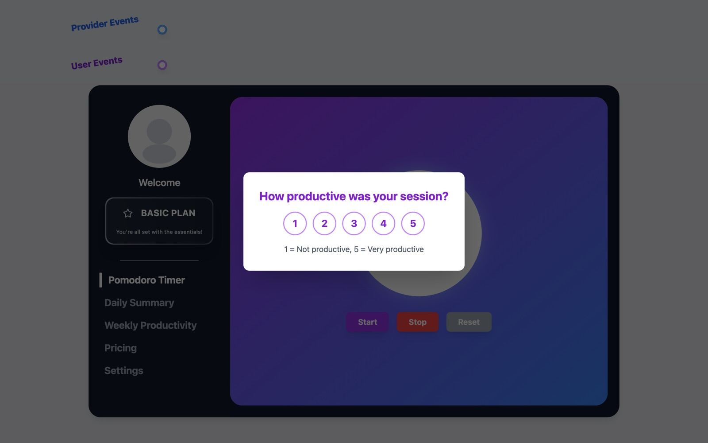

After the third one, the controls are replaced by the limit screen.

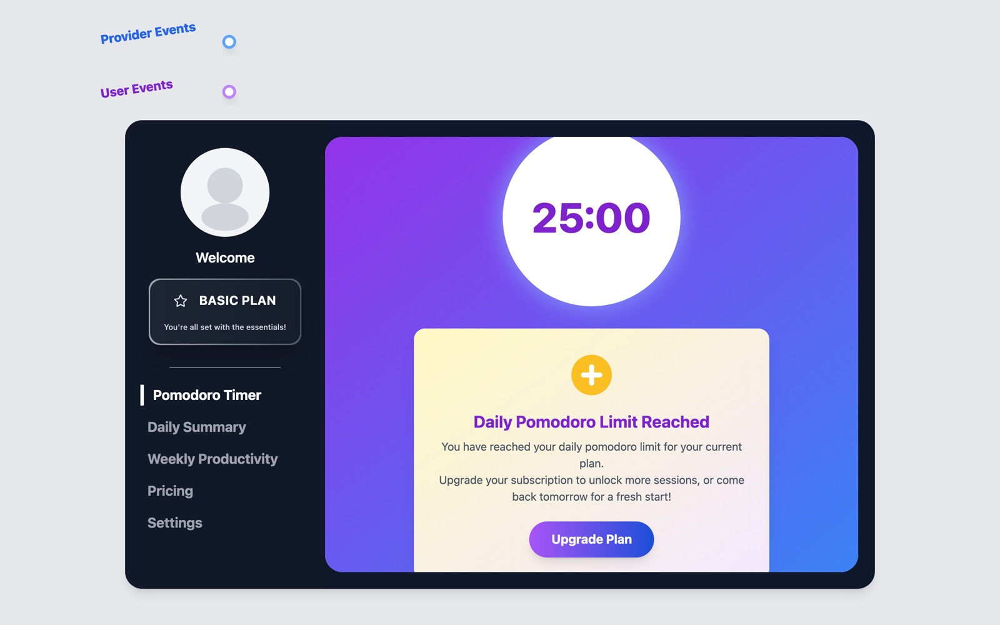

The backend enforces it too. A fourth request is rejected:

```bash
curl -s -X POST localhost:5401/api/pomodoro/session -H 'content-type: application/json' -d '{"duration":60}'
```

```text
{"error":"Daily pomodoro limit reached"}
```

### F5 · Restrict the Daily summary to ADVANCED and PREMIUM

**File:** `src/pages/daily-summary/daily-summary.tsx`

Wrap the summary in `<Feature id="tomatometer-dailySummary">`, from `space-react-client`:

- `<On>`: the existing `<DailySummaryList />`.
- `<Default>`: the ready-made `<UpgradeRequired plan="ADVANCED">unlock your daily pomodoro summary!</UpgradeRequired>`.

<details>
<summary>Solution</summary>

```tsx
import { Default, Feature, On } from 'space-react-client';
import DailySummaryList from '../../components/daily-summary-list';
import { UpgradeRequired } from '../../components/upgrade';

const DailySummaryPage = () => {
  // --------------------------------------
  // F5 · Restrict the Daily summary to the ADVANCED and PREMIUM plans
  // ...
  // --------------------------------------
  return (
    <Feature id="tomatometer-dailySummary">
      <On>
        <DailySummaryList />
      </On>
      <Default>
        <UpgradeRequired plan="ADVANCED">unlock your daily pomodoro summary!</UpgradeRequired>
      </Default>
    </Feature>
  );
};

export default DailySummaryPage;
```

</details>

**✅ Check.** On the BASIC plan, the Daily Summary page asks you to upgrade.

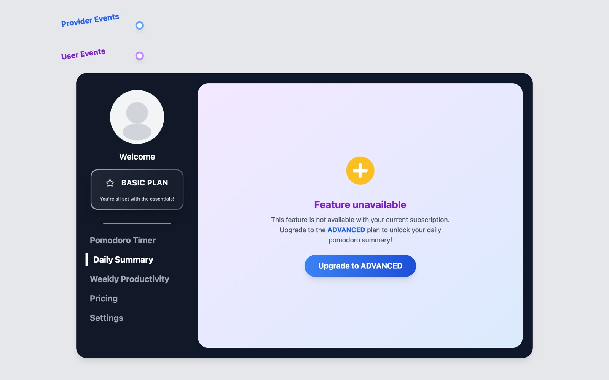

### Upgrade the plan

Go to **Pricing** and click **Select ADVANCED** under the comparison table.

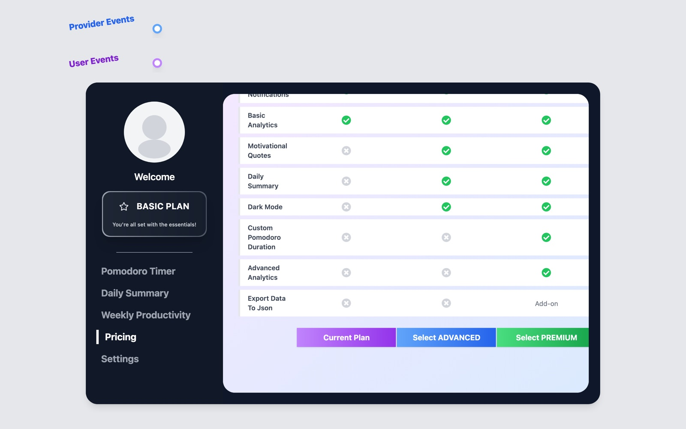

The sidebar now shows the ADVANCED plan, the Daily Summary unlocks and the timer is available again (10 pomodoros per day).

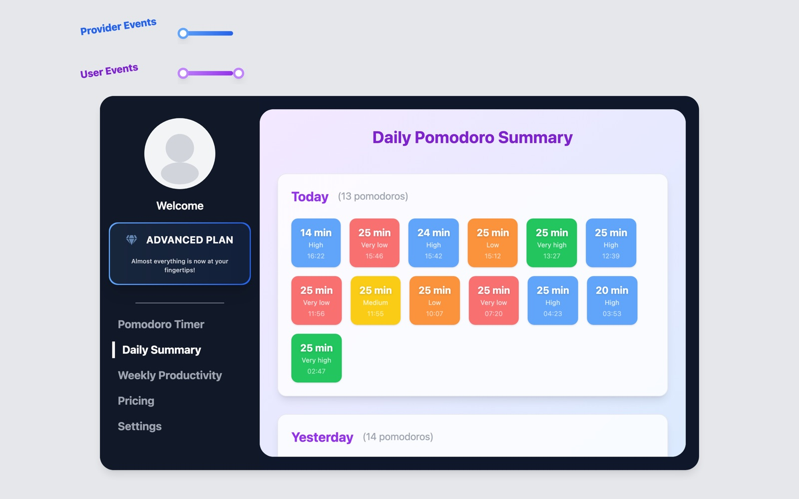

### ✅ Check

- On BASIC: Daily Summary locked, timer locked after 3 pomodoros, backend answers 403.
- On ADVANCED: Daily Summary unlocked, 10 pomodoros per day.

---

## Part 4 · Change the pricing and watch TomatoMeter adapt

You will change the BASIC plan in SPHERE so that it includes the **Daily summary** and **5 pomodoros per day**, and watch TomatoMeter adapt **without touching the code**.

### 4.1 Prepare TomatoMeter

In TomatoMeter, go back to the **BASIC** plan (Pricing → *Select BASIC*) and open **Daily Summary**. It is locked. Keep this tab open where you can see it.


### 4.2 Edit the pricing

In SPHERE, open your TomatoMeter pricing and click **New version → Visual editor**.

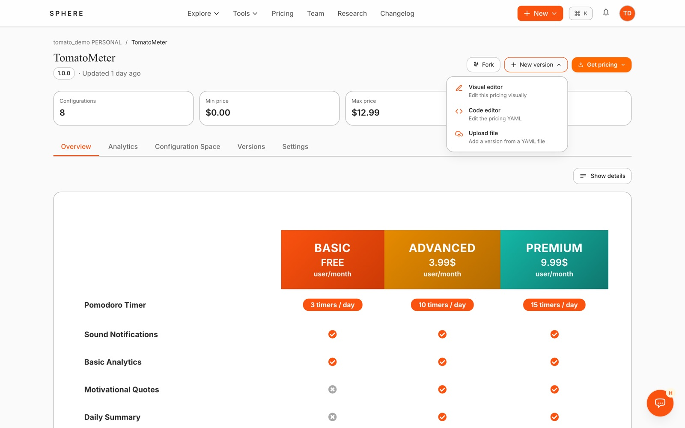

The Visual editor opens version 1.0.0. Change the BASIC plan:

1. Click the **Daily Summary** cell under BASIC to switch it on.
2. In the *Max Pomodoro Timers* row, click **3 timers / day** under BASIC, type `5` and press **Enter**.

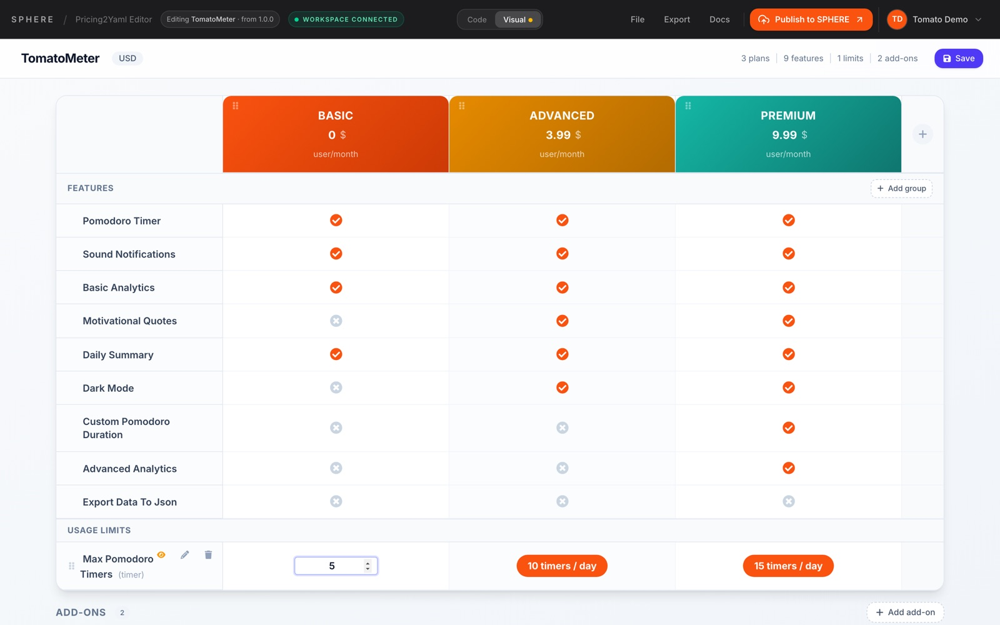

Click **Save**. BASIC now includes the Daily Summary and **5 timers / day**.

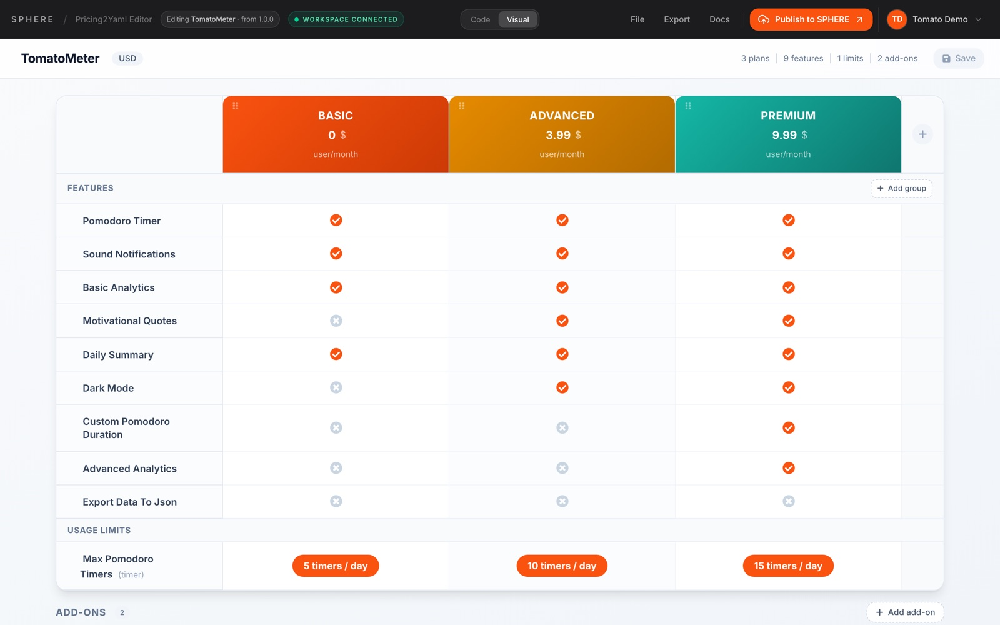

### 4.3 Publish the new version

Click **Publish to SPHERE**. The dialog selects **New version** of TomatoMeter. Fill in:

- **Visibility**: **Public**.
- **Version name**: `1.1.0`. You did not change the version in the editor, so SPHERE asks you to name it.
- **Release date**: keep the default (now), so that this becomes the latest version.

Click **Publish version**.

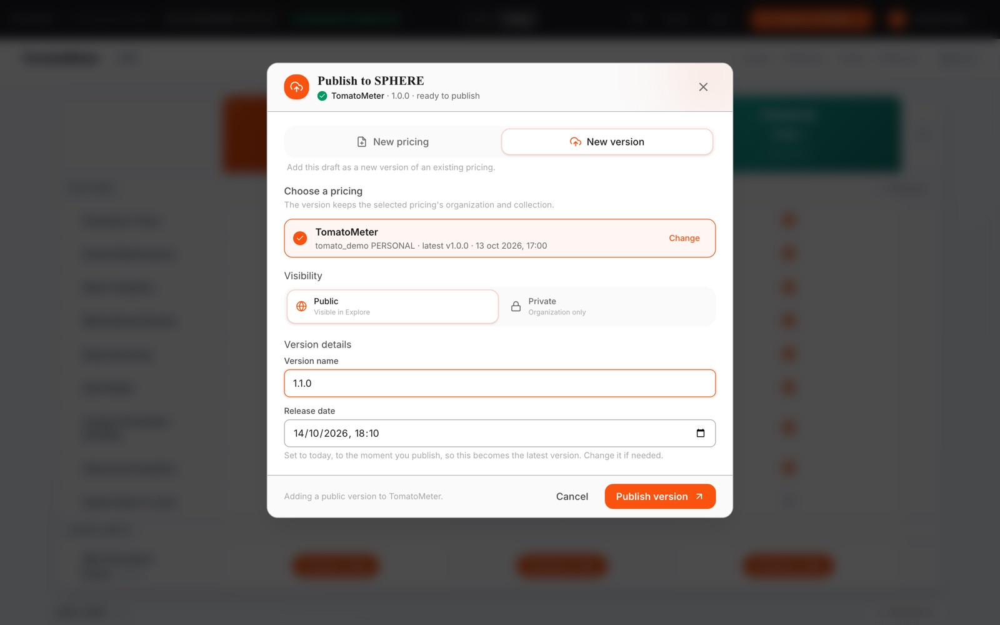

### 4.4 Watch TomatoMeter

Go back to the TomatoMeter tab and **do not reload it**. Within a minute, SPACE detects version 1.1.0, migrates the user's contract and notifies TomatoMeter. The Daily Summary unlocks by itself, and the timeline at the top records a *provider event*.

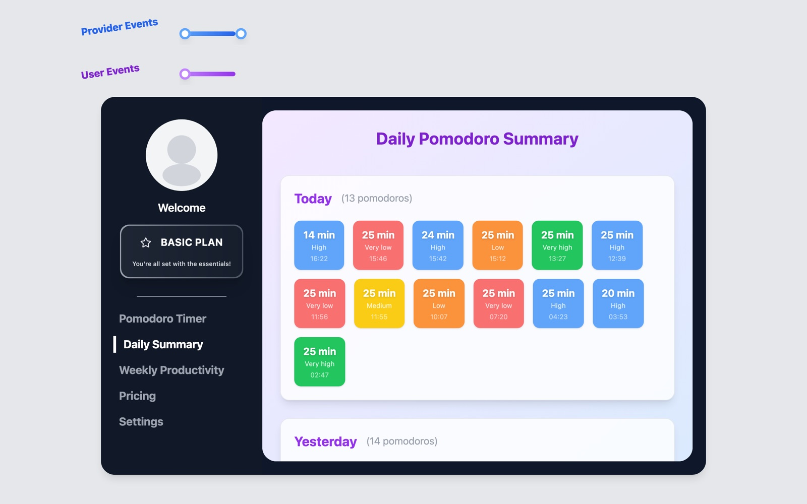

Open **Pomodoro Timer**: the controls are back, because BASIC now allows 5 pomodoros per day and you have used 3. Your usage was kept during the migration. (If you ran more than 5 pomodoros while on ADVANCED, the timer stays locked: that is the new limit at work.)

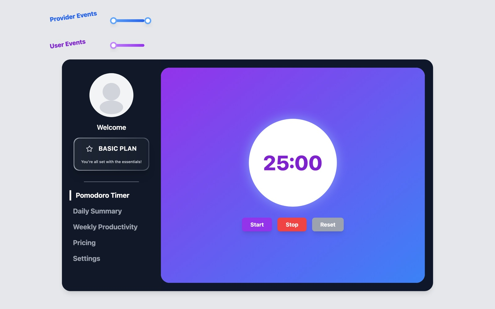

In SPACE, the **tomatometer** service now applies **v1.1.0**, and its *Latest synchronization* section shows the contracts it migrated.


### ✅ Check

- SPACE applies v1.1.0.
- TomatoMeter unlocked the Daily Summary on BASIC without a reload, and allows 5 pomodoros per day.

---

## Wrap-up

You closed the whole cycle of **pricing-driven self-adaptation**:

| Step | Who | What happened |
|------|-----|---------------|
| Design | You, in SPHERE | The pricing became a versioned, public artifact with a permanent link. |
| Operation | SPACE | It follows that link, imports every new version, migrates the contracts and notifies the apps. |
| Enforcement | SPACE & TomatoMeter | The backend evaluates features and consumes usage in SPACE (B2); the frontend renders from the pricing token (F2, F4, F5), also generated by SPACE. |
| Adaptation | TomatoMeter | On `pricing_actived` it renews the token and re-renders (F3): the new pricing took effect without a code change or a redeploy. |

Try more changes on your own: lower a limit, move `darkMode` to BASIC, or remove a feature from a plan, and publish new versions.

To stop the lab and delete its data:

```bash
npm run down
```

---

## Troubleshooting

| Symptom | What to do |
|---------|------------|
| The Pricing page says *"not connected to SPACE"* | Check that `VITE_SPACE_API_KEY` is set in `tutorial/tomatometer/.env` and that B1 is done. |
| The Pricing page says *"Waiting for the TomatoMeter service in SPACE"* | TomatoMeter is connected, but the service does not exist in SPACE yet (Part 2). |
| SPACE rejects the permanent link | Use the link exactly as SPHERE copies it (`http://localhost:5402/p/…`), and make sure the pricing is **public**. |
| A page that uses `<Feature>` renders nothing | The pricing token is not loaded: check F1 and F2, and the browser console. |
| The page goes blank after F2 | `useSpaceClient()` is outside `<SpaceProvider>`: finish F1. |
| The editor shows *"Error parsing plan basic"* | Every plan needs a `features` entry, even if it is `features: null`. |
| Changes made in the Visual editor are not published | Click **Save** in the Visual editor before **Publish to SPHERE**; the orange dot next to *Visual* means there are unsaved changes. |
| Nothing changes after publishing a new version | Make sure the new version is **public**, wait up to a minute, and check the service page in SPACE. |
| You want the starter code back | Run `git checkout -- tutorial/tomatometer`. |
| You want SPHERE and SPACE back to a known state | Run `npm run tutorial:1`, `tutorial:2` or `tutorial:3`. Your code is kept. |
