# TomatoMeter Lab Manual

**ICSOC 2026 Tutorial · Pricing-driven Self-adaptation**

In this lab you take **TomatoMeter**, a Pomodoro app that knows nothing about pricing, and make it *pricing-driven*. No code change, no redeploy: by the end, editing the pricing is enough to change how the app behaves.

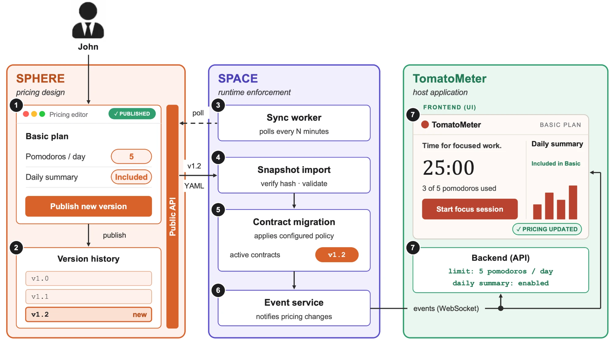

## The lab at a glance

| Part | Where you work | What you do | You are done when… | Starting late? |
|:----:|----------------|-------------|--------------------|----------------|
| [**0**](#part-0--set-up-the-lab) | Terminal | Start the lab | All three apps open in the browser | — |
| [**1**](#part-1--design-the-pricing-in-sphere) | SPHERE | **Design** the pricing and publish it | Version 1.0.0 is public and you have its permanent link | — |
| [**2**](#part-2--operate-the-pricing-with-space) | SPACE | **Operate** the pricing, linked to SPHERE | SPACE applies v1.0.0 and `.env` has the API key | `npm run tutorial:2` |
| [**3**](#part-3--connect-tomatometer-to-space) | Code editor | **Connect** TomatoMeter to SPACE (7 TODOs) | Features lock and unlock by plan | `npm run tutorial:3` |
| [**4**](#part-4--change-the-pricing-and-watch-tomatometer-adapt) | SPHERE + TomatoMeter | **Change** the pricing and watch the app adapt | Daily Summary unlocks on BASIC without a reload | — |

Then: [Wrap-up](#wrap-up) · [Troubleshooting](#troubleshooting)

<details open>
<summary><b>📌 Quick reference</b> (URLs, credentials, commands)</summary>

| | |
|---|---|
| **TomatoMeter** | <http://localhost:5401> |
| **SPHERE** | <http://localhost:5402> |
| **SPACE** | <http://localhost:5403> |
| **Credentials** (SPHERE and SPACE) | `tomato_demo` / `tomato-demo` |
| **Code you edit** | `tutorial/tomatometer` |
| **Full solution** | [`tutorial/solution`](solution) |
| **Reset SPHERE and SPACE** to the start of Part 1, 2 or 3 (your code is kept) | `npm run tutorial:1` · `tutorial:2` · `tutorial:3` |
| **Restore the starter code** | `git checkout -- tutorial/tomatometer` |
| **Stop the lab and delete its data** | `npm run down` |

</details>

<details>
<summary><b>📖 How to read this manual</b></summary>

- Follow the parts in order. **Each part is folded**: click its 🎯 Goal line to open it, and close it again when you finish.
- Inside a part, the instructions are always visible; everything optional is folded away.
- **📸 Screenshots** are folded under each step. Open them if you are not sure where to click.
- **🔍 Why?** blocks explain what is going on. Useful, but you can skip them during the session.
- **💡 Solution** blocks (Part 3) hide the code. Try first; open them if you get stuck.
- **✅ Check** lists end each step or part. Make sure you see the same before moving on.
- **⏩ Starting here?** boxes tell you how to jump straight into a part with everything already set up.

</details>

---

## Part 0 · Set up the lab

<details>
<summary><b>🎯 Goal:</b> have TomatoMeter, SPHERE and SPACE running on your machine. <i>(click to open)</i></summary>

### 0.1 Requirements

- **Docker** (Desktop or Engine) with Docker Compose, **running**.
- **Node.js** with npm.
- **Git** and a code editor (VS Code or similar).
- Ports `5401`, `5402` and `5403` free.

### 0.2 Get the code and start the lab

```bash
git clone https://github.com/SCORELabUS/TomatoMeter.git
```

```bash
cd TomatoMeter
```

```bash
npm run tutorial:1
```

The first start downloads several images and installs TomatoMeter's dependencies, so it can take a few minutes. When it is ready, the terminal prints:

```text
Laboratory ready (stage: empty): SPHERE and SPACE only contain the tomato_demo user.

  TomatoMeter  http://localhost:5401  (dev mode: edits in tutorial/tomatometer reload automatically)
  SPHERE       http://localhost:5402
  SPACE        http://localhost:5403
  Credentials  tomato_demo / tomato-demo  (SPHERE and SPACE)
```

**Leave this terminal open.** It keeps showing TomatoMeter's logs (`[api]` for the backend, `[web]` for the frontend), and you will need them in Part 3. `Ctrl+C` only stops following the logs; the lab keeps running.

> 💡 **Tip:** Optional: for autocompletion in your editor, run `npm install` inside `tutorial/tomatometer`. TomatoMeter itself runs inside Docker and does not need it.

### 0.3 Take a look at TomatoMeter

1. Open <http://localhost:5401>. This is the **starter**: it has no pricing at all, so every page is open to everyone.
2. Go to **Daily Summary**: anyone can see it.
3. Open **Pricing**: TomatoMeter says it is not connected to SPACE. That is what you will fix.
4. Open the folder `tutorial/tomatometer` in your editor. This is the code you will edit.

<details>
<summary>📸 Screenshots</summary>

**The starter shows the Daily Summary to everyone**

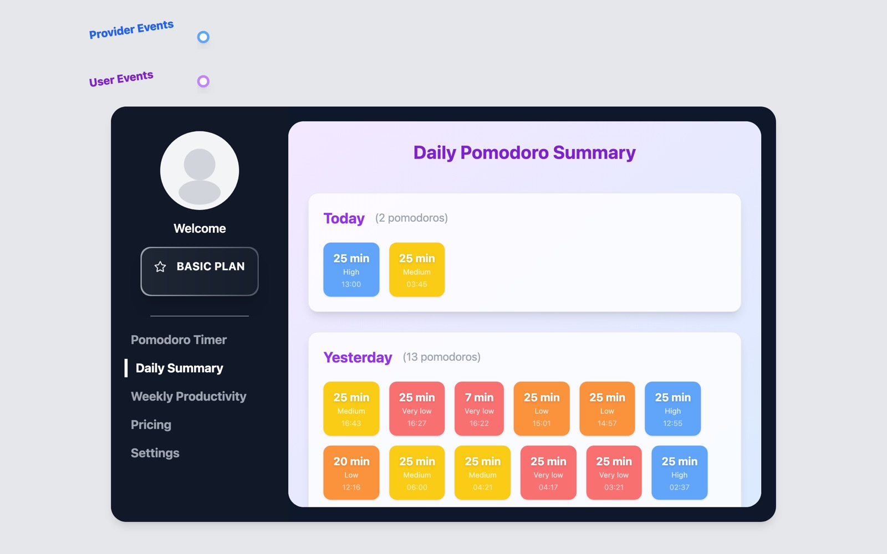

**The Pricing page is not connected to SPACE**

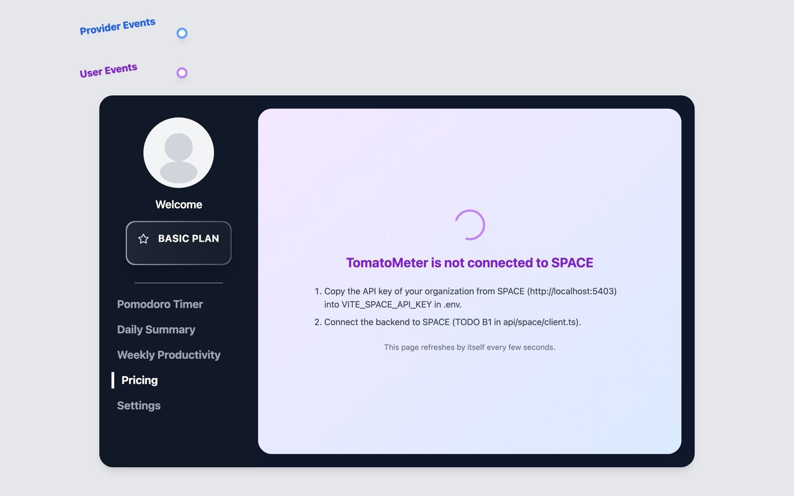

</details>

### ✅ Check

- [ ] TomatoMeter, SPHERE and SPACE open in your browser.
- [ ] The Pricing page says *"TomatoMeter is not connected to SPACE"*.

</details>

---

## Part 1 · Design the pricing in SPHERE

<details>
<summary><b>🎯 Goal:</b> design this pricing (three plans, a daily limit of pomodoros and two add-ons), publish it in SPHERE and get its permanent link. <i>(click to open)</i></summary>

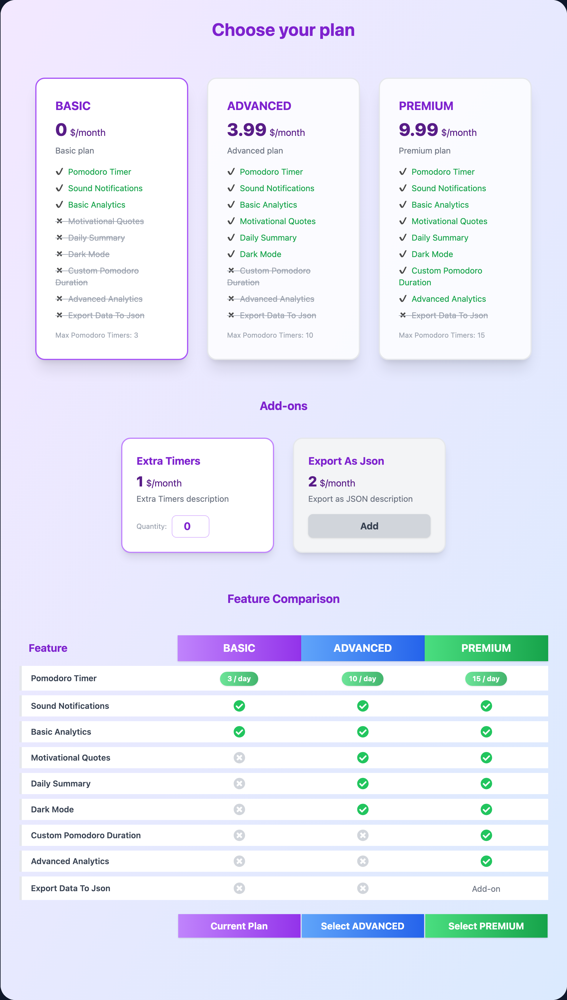

> ❗ **Important:** TomatoMeter's code refers to the pricing by name. Keep the names exactly as in the YAML below: the SaaS name `TomatoMeter`, the plans `basic`, `advanced` and `premium`, the features (`pomodoroTimer`, `dailySummary`…) and the usage limit `maxPomodoroTimers`.

### 1.1 Log in

Open SPHERE at <http://localhost:5402>, click **LOGIN** and sign in as `tomato_demo` / `tomato-demo`.

<details>
<summary>📸 Screenshot</summary>

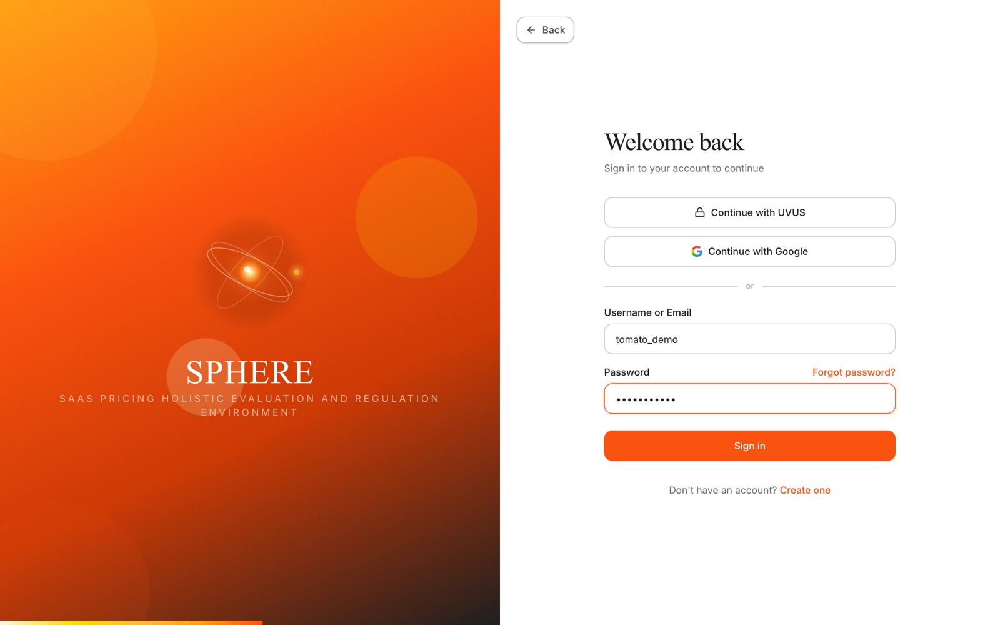

</details>

### 1.2 Open the Pricing Editor

1. On your workspace, click **Pricing Editor** under *Quick Actions*.
2. The editor opens in **Code** mode with an example pricing (PetClinic): YAML on the left, live preview on the right.
3. Click **File → Clear** to start from an empty document.

> ℹ️ **Note:** The editor has two modes, switched at the top: **Code**, where you write the YAML, and **Visual**, where you edit the pricing as a table. You will use both.

<details>
<summary>📸 Screenshots</summary>

**Your SPHERE workspace**

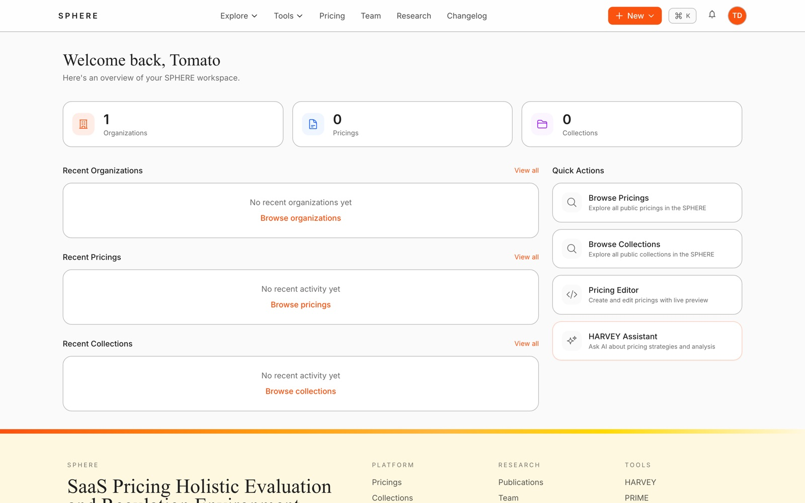

**The editor with the example pricing**

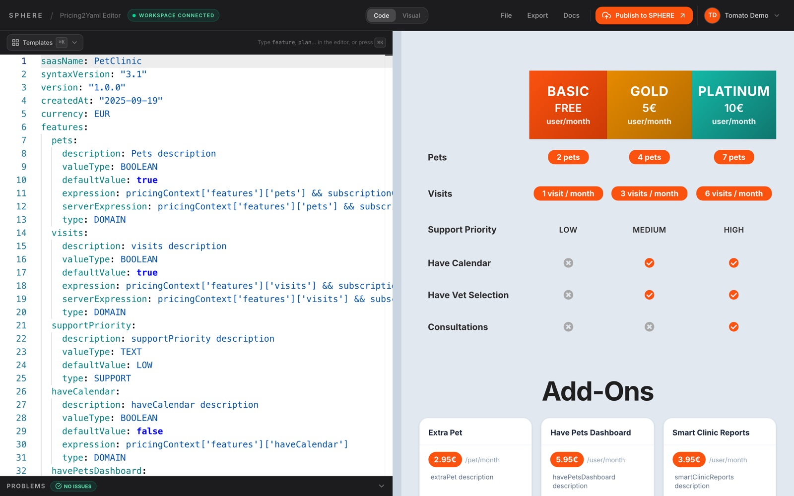

**File → Clear**

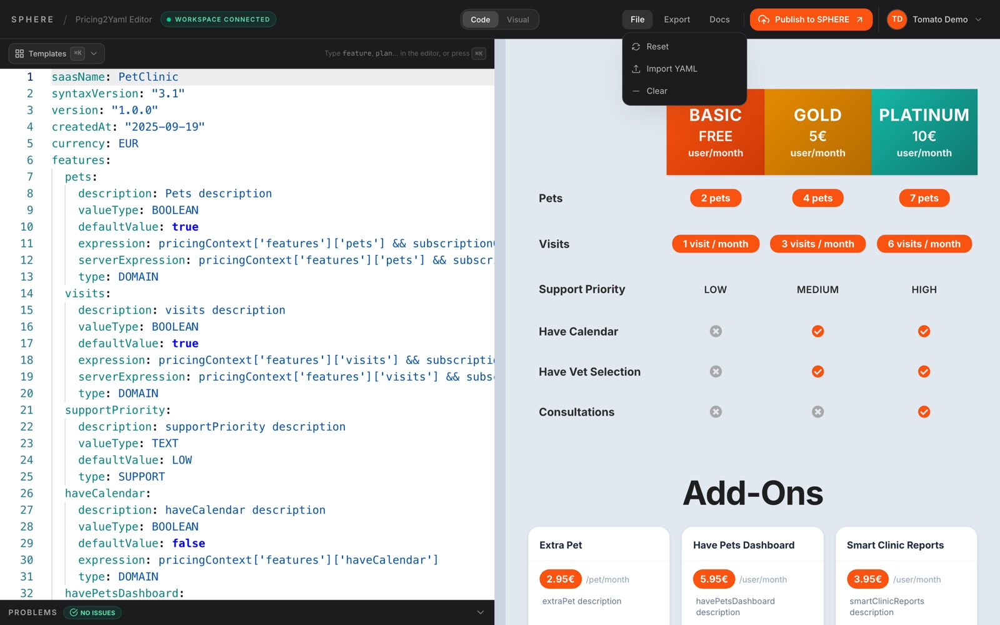

</details>

### 1.3 Declare the building blocks

Copy the YAML below (open the block, then use the copy button at its top right) and paste it into the empty editor. It declares everything your plans are built from:

| Building block | What is in it |
|---|---|
| **SaaS** | `TomatoMeter`, version `1.0.0`, in USD |
| **9 features** | `pomodoroTimer`, `soundNotifications`, `basicAnalytics`, `motivationalQuotes`, `dailySummary`, `darkMode`, `customPomodoroDuration`, `advancedAnalytics`, `exportDataToJson` |
| **1 usage limit** | `maxPomodoroTimers`: 3 timers per day by default |
| **3 plans** | `basic` ($0), `advanced` ($3.99), `premium` ($9.99), with no features assigned yet |
| **2 add-ons** | `extraTimers` (+5 timers/day per unit) and `exportAsJson` (premium only) |

<details>
<summary><b>📄 TomatoMeter pricing YAML</b> (click to expand and copy)</summary>

```yaml
saasName: TomatoMeter
syntaxVersion: "3.1"
version: "1.0.0"
createdAt: "2026-10-14"
currency: USD
features:
  pomodoroTimer:
    description: Start pomodoro timers
    valueType: BOOLEAN
    defaultValue: true
    expression: pricingContext['features']['pomodoroTimer'] && subscriptionContext['maxPomodoroTimers'] < pricingContext['usageLimits']['maxPomodoroTimers']
    type: DOMAIN
  soundNotifications:
    description: Ring a sound every time a timer finishes or is stopped
    valueType: BOOLEAN
    defaultValue: true
    expression: pricingContext['features']['soundNotifications']
    type: AUTOMATION
    automationType: TRACKING
  basicAnalytics:
    description: Weekly productivity analytics, such as the Tomato Score
    valueType: BOOLEAN
    defaultValue: true
    expression: pricingContext['features']['basicAnalytics']
    type: INFORMATION
  motivationalQuotes:
    description: Show a motivational quote above the timer
    valueType: BOOLEAN
    defaultValue: false
    expression: pricingContext['features']['motivationalQuotes']
    type: DOMAIN
  dailySummary:
    description: Overview of completed pomodoros by day over the last month
    valueType: BOOLEAN
    defaultValue: false
    expression: pricingContext['features']['dailySummary']
    type: INFORMATION
  darkMode:
    description: A dark color scheme for low-light environments
    valueType: BOOLEAN
    defaultValue: false
    expression: pricingContext['features']['darkMode']
    type: DOMAIN
  customPomodoroDuration:
    description: Custom durations for pomodoros and breaks
    valueType: BOOLEAN
    defaultValue: false
    expression: pricingContext['features']['customPomodoroDuration']
    type: DOMAIN
  advancedAnalytics:
    description: Productivity trends, pomodoro streaks and more
    valueType: BOOLEAN
    defaultValue: false
    expression: pricingContext['features']['advancedAnalytics']
    type: INFORMATION
  exportDataToJson:
    description: Export pomodoro data as JSON
    valueType: BOOLEAN
    defaultValue: false
    expression: pricingContext['features']['exportDataToJson']
    type: DOMAIN
usageLimits:
  maxPomodoroTimers:
    description: Maximum number of pomodoro timers per day
    valueType: NUMERIC
    defaultValue: 3
    unit: timer
    type: RENEWABLE
    period:
      unit: DAY
      value: 1
    linkedFeatures:
      - pomodoroTimer
plans:
  basic:
    description: Basic plan
    price: 0.0
    unit: user/month
    features: null
  advanced:
    description: Advanced plan
    price: 3.99
    unit: user/month
    features: null
  premium:
    description: Premium plan
    price: 9.99
    unit: user/month
    features: null
addOns:
  extraTimers:
    description: 5 extra pomodoro timers per day for each unit
    price: 1.00
    unit: month
    usageLimitsExtensions:
      maxPomodoroTimers:
        value: 5
  exportAsJson:
    description: Export your pomodoro data as JSON
    availableFor:
      - premium
    price: 2.00
    unit: month
    features:
      exportDataToJson:
        value: true
```

</details>

> ℹ️ **Note:** We declare these building blocks in code only to save time during the session. Everything can also be created from the **Visual** editor, which has buttons to add features (**ADD FEATURE**), usage limits (**ADD USAGE LIMIT**) and plans (**+**).

**✅ Check**

- [ ] The preview on the right shows the three plans, each with **Pomodoro Timer · 3 timers / day**.
- [ ] The **Problems** panel shows **no errors** (red icons). Warnings are expected.

<details>
<summary>🔍 Why? Understanding the preview and the warnings</summary>

- **Pomodoro Timer shows 3 timers / day in every plan.** The usage limit `maxPomodoroTimers` (`defaultValue: 3`) is linked to the feature `pomodoroTimer` through `linkedFeatures`. Features and usage limits are written in camelCase in the YAML.
- **Features with `defaultValue: true` show a check in every plan**, even though no plan declares them yet: a plan inherits the `defaultValue` of every feature it does not declare.
- **The warnings are normal.** No plan overwrites the value of any feature yet, so every plan is assigned their `defaultValue`. You will fix that in the next step.

</details>

<details>
<summary>📸 Screenshot</summary>

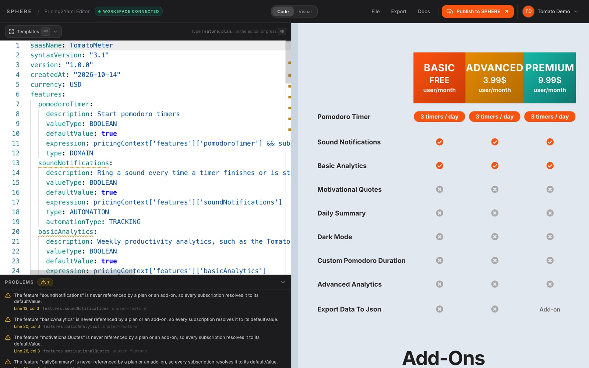

</details>

### 1.4 Design the plans in the Visual editor

From now on, you make every change in the **Visual** editor. Click **Visual** at the top of the editor: plans are in the columns, features and usage limits in the rows.

**① Choose what each plan includes.** Click a cell to switch a feature on (orange check) or off (grey cross):

| Feature | BASIC | ADVANCED | PREMIUM |
|---------|:-----:|:--------:|:-------:|
| Motivational Quotes | *leave as is* | ✔ | ✔ |
| Daily Summary | *leave as is* | ✔ | ✔ |
| Dark Mode | *leave as is* | ✔ | ✔ |
| Custom Pomodoro Duration | *leave as is* | | ✔ |
| Advanced Analytics | *leave as is* | | ✔ |
| Export Data To Json | ✘ | ✘ | ✘ *(comes with an add-on)* |

**② Set the daily limits.** In the *Max Pomodoro Timers* row, click **3 timers / day** and type the new value, then press **Enter**:

| | BASIC | ADVANCED | PREMIUM |
|---|:---:|:---:|:---:|
| Max Pomodoro Timers | 3 *(leave as is)* | **10** | **15** |

**③ Save.** Click **Save** at the top right. The orange dot next to *Visual* disappears.

**✅ Check**

- [ ] The table matches the two tables above, and there is no orange dot next to *Visual*.
- [ ] Scrolling down, you see the two add-ons. *Export As Json* is only available for **premium** and unlocks *Export Data To Json*.

The pricing now matches the [target pricing](../demo/api/resources/TomatoMeter.yml).

> 💡 **Tip:** Want to see what the Visual editor wrote? Switch to **Code**: the `plans` section now lists the features and limits of each plan.

<details>
<summary>📸 Screenshots</summary>

**The pricing in the Visual editor, before your changes**


**① Features switched on for ADVANCED and PREMIUM**

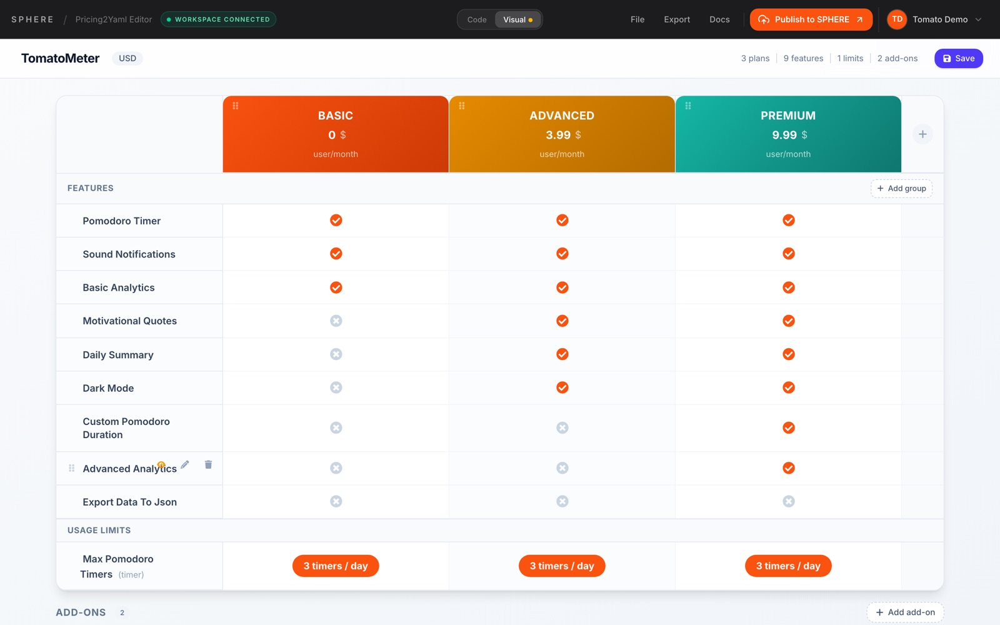

**② Editing the ADVANCED limit**

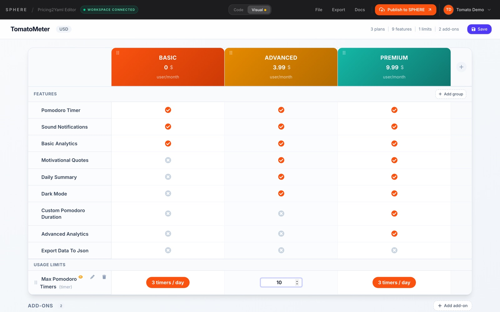

**③ The plans, saved**

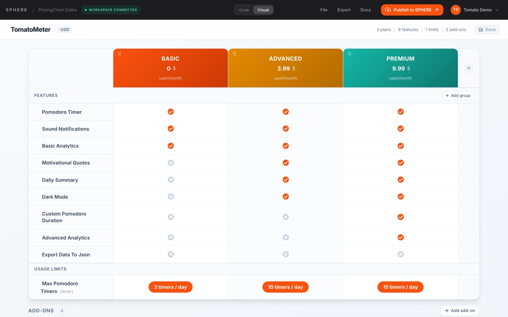

**The add-ons**

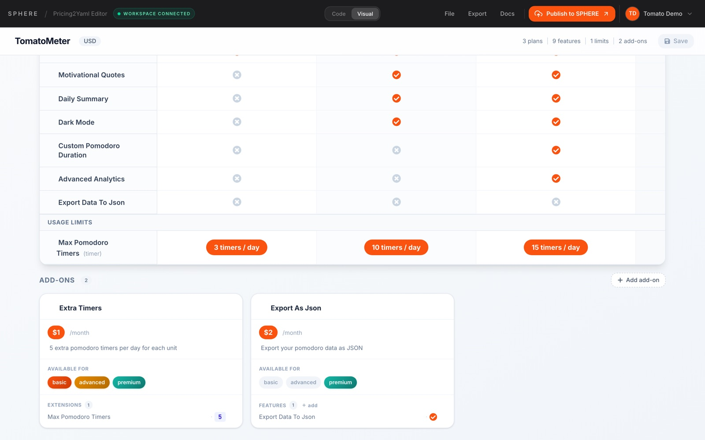

</details>

### 1.5 Publish it

Click **Publish to SPHERE**, fill in the dialog and click **Publish**:

| Field | Value |
|---|---|
| Type | **New pricing** |
| Organization | `tomato_demo PERSONAL` |
| Pricing name | `TomatoMeter` |
| Visibility | **Public**. SPACE can only synchronize public versions. |

SPHERE opens the page of your pricing, version **1.0.0**.

<details>
<summary>📸 Screenshots</summary>

**The publish dialog**

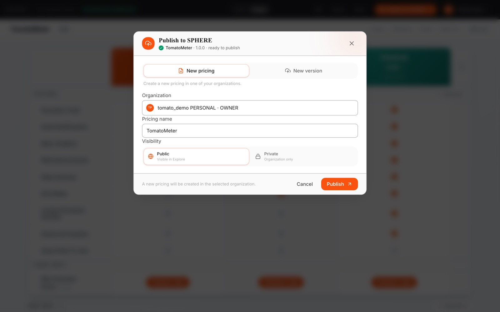

**The published pricing in SPHERE**

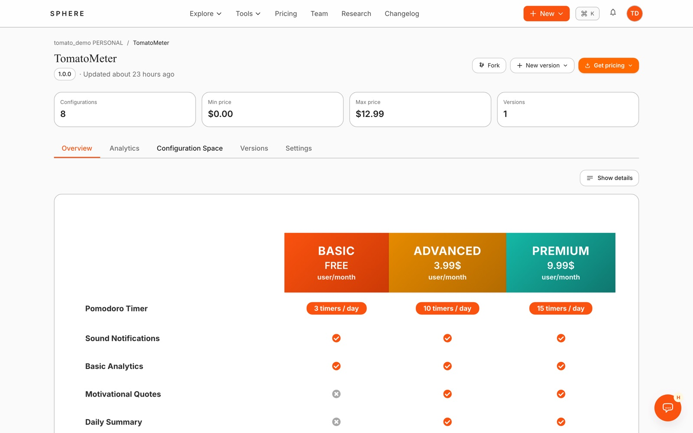

</details>

### 1.6 Copy the permanent link

Click **Get pricing** and copy the **Permanent link** with the copy button. It looks like `http://localhost:5402/p/6ad0…`.

> ❗ **Important:** Keep this link at hand: you need it in Part 2. It always points to the pricing, whatever versions you publish later.

<details>
<summary>📸 Screenshot</summary>

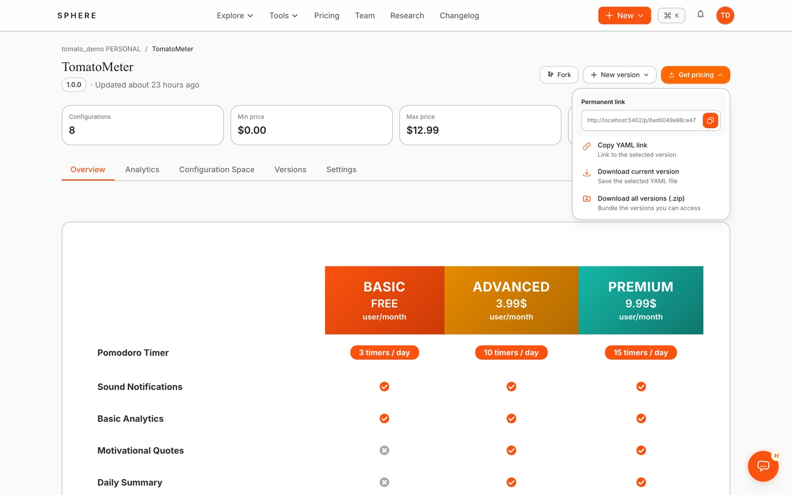

</details>

### ✅ Check

- [ ] Your TomatoMeter pricing, version 1.0.0, is published and **public** in SPHERE.
- [ ] You have its permanent link.

</details>

---

## Part 2 · Operate the pricing with SPACE

> [!TIP]
> **⏩ Starting here?** Run `npm run tutorial:2` to get the pricing already published (it resets SPHERE and SPACE). Then get the permanent link: log in to SPHERE, open **Browse Pricings → TomatoMeter** and use **Get pricing** (as in [step 1.6](#16-copy-the-permanent-link)).

<details>
<summary><b>🎯 Goal:</b> create a TomatoMeter service in SPACE that follows your pricing in SPHERE, and give TomatoMeter an API key for SPACE. <i>(click to open)</i></summary>

### 2.1 Log in

Open SPACE at <http://localhost:5403> and log in as `tomato_demo` / `tomato-demo`. Your organization, **TomatoMeter Lab**, is already there, with no services yet.

<details>
<summary>📸 Screenshots</summary>

**SPACE login**

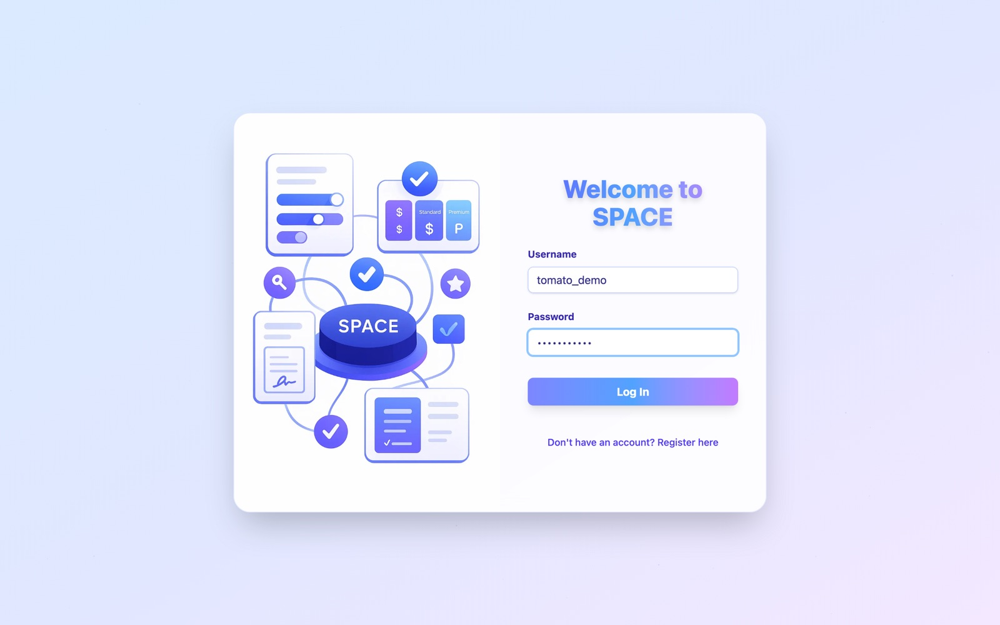

**SPACE overview**

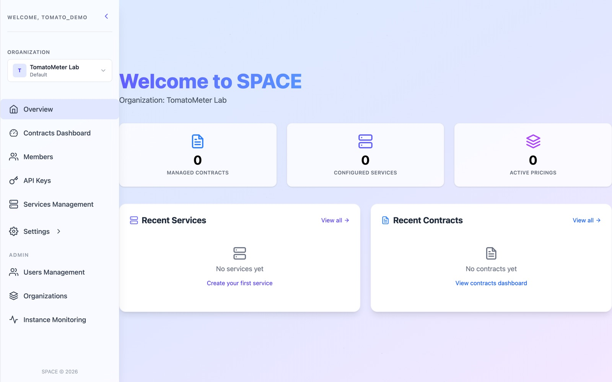

</details>

### 2.2 Link the TomatoMeter service to SPHERE

Go to **Services Management**, click **Add Service** and fill in the dialog:

| Field | Value |
|---|---|
| Pricing source | **Link to SPHERE** |
| SPHERE permanent link | Paste the link from step 1.6, then click **Check pricing and versions**. SPACE finds *TomatoMeter · 1 public versions*. |
| Synchronization policy | **All last version**: every contract always follows the latest published version. |
| Check for new versions | **Every minute** |

Click **Link service**, then open the new **tomatometer** service.

**✅ Check**

- [ ] SPACE shows the service is connected to SPHERE and applies version **v1.0.0**.

<details>
<summary>📸 Screenshots</summary>

**Services Management**

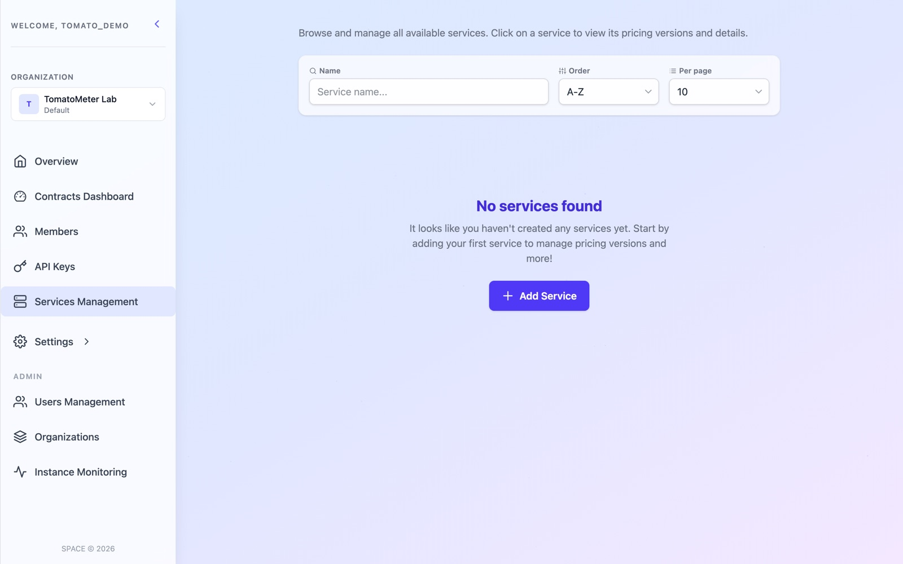

**The Add Service dialog**

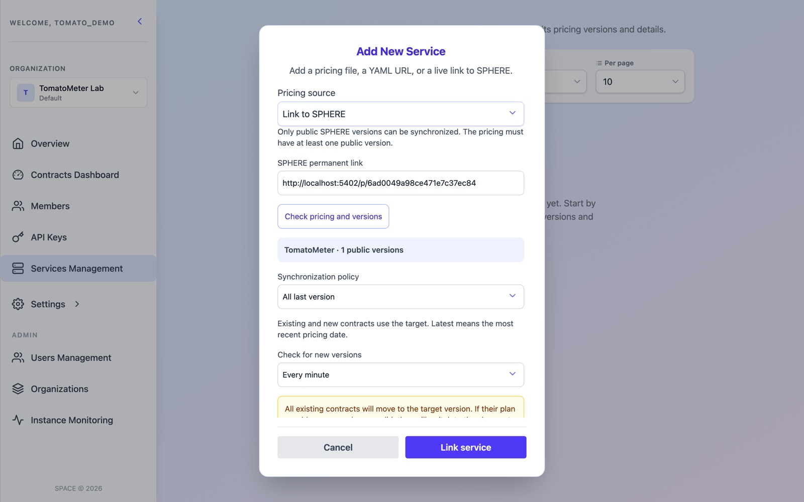

**The service linked to SPHERE**


</details>

### 2.3 Give TomatoMeter access to SPACE

1. Go to **API Keys** and copy the organization key with the copy button.
2. Open `tutorial/tomatometer/.env` in your editor and paste it:

   ```dotenv
   VITE_SPACE_API_KEY=org_…
   ```

3. Save the file. TomatoMeter reloads by itself; there is nothing to restart.

> ⚠️ **Warning:** It's normal that TomatoMeter's Pricing page still says it is not connected. The code does not "talk" to SPACE yet: that is Part 3.

<details>
<summary>📸 Screenshot</summary>

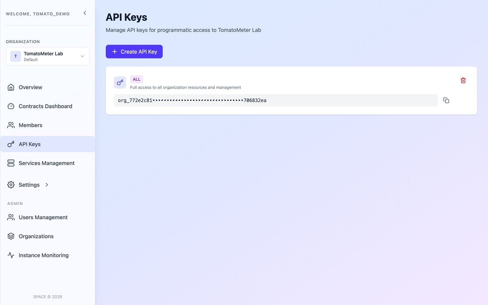

</details>

### ✅ Check

- [ ] SPACE has a **tomatometer** service linked to SPHERE, applying v1.0.0.
- [ ] `tutorial/tomatometer/.env` contains your API key.

</details>

---

## Part 3 · Connect TomatoMeter to SPACE

> [!TIP]
> **⏩ Starting here?** Run `npm run tutorial:3`. The service is linked in SPACE and the API key is already in `.env`.

<details>
<summary><b>🎯 Goal:</b> write the integration code so that TomatoMeter enforces the pricing. <i>(click to open)</i></summary>

Everything else is already in place: the screens for locked features, the Pricing page, and the creation of a contract in SPACE for the demo user (`test-user-id`) on the cheapest plan. You only fill in the places marked with `TODO` in the code. Every time you save a file, TomatoMeter reloads; keep the terminal with the logs in view.

### Two ideas you need

| Idea | In short |
|---|---|
| **Feature ids** | `<saas name in lowercase>-<feature name>`, e.g. `tomatometer-pomodoroTimer`, `tomatometer-dailySummary`, `tomatometer-maxPomodoroTimers`. |
| **Pricing token** | The frontend never asks SPACE about each feature. It loads a signed snapshot with the evaluation of every feature for the user. The `<Feature>` component reads it and re-renders whenever the token changes. |

### Your roadmap

**B** = backend (`api/`), **F** = frontend (`src/`). Do them in this order.

| | TODO | File | What to do |
|---|------|------|------------|
| ☐ | [**B1**](#b1--connect-the-backend-to-space) | [api/space/client.ts](tomatometer/api/space/client.ts) | Connect the backend to SPACE with `space-node-client`. |
| ☐ | [**F1**](#f1--connect-the-frontend-to-space) | [src/App.tsx](tomatometer/src/App.tsx) | Wrap the app in `<SpaceProvider>` from `space-react-client`. |
| ☐ | [**F2**](#f2--load-the-users-pricing-token) | [src/contexts/subscriptionContext/index.tsx](tomatometer/src/contexts/subscriptionContext/index.tsx) | Load the user's pricing token with `spaceClient.setUserId(...)`. |
| ☐ | [**F3**](#f3--react-to-pricing-changes) | [src/contexts/subscriptionContext/index.tsx](tomatometer/src/contexts/subscriptionContext/index.tsx) | Listen to `pricing_actived` and refresh the subscription. |
| ☐ | [**B2**](#b2--enforce-the-daily-pomodoro-limit-on-the-server) | [api/routes/pomodoro.ts](tomatometer/api/routes/pomodoro.ts) | Before saving a pomodoro, evaluate `tomatometer-pomodoroTimer` while consuming one `tomatometer-maxPomodoroTimers`; reply 403 if not allowed. |
| ☐ | [**F4**](#f4--show-the-timer-controls-only-while-pomodoros-are-left) | [src/pages/pomodoro-timer/pomodoro-timer.tsx](tomatometer/src/pages/pomodoro-timer/pomodoro-timer.tsx) | Show the timer controls only while pomodoros are left. |
| ☐ | [**F5**](#f5--restrict-the-daily-summary-to-advanced-and-premium) | [src/pages/daily-summary/daily-summary.tsx](tomatometer/src/pages/daily-summary/daily-summary.tsx) | Restrict the Daily Summary to ADVANCED and PREMIUM. |

> 💡 **Tip:** Each TODO has a **💡 Solution** folded below it. Try first; open it if you get stuck. The full solution is also in [`tutorial/solution`](solution).

---

### B1 · Connect the backend to SPACE

📄 **File:** [`api/space/client.ts`](tomatometer/api/space/client.ts)

Create the SPACE client with `connect()` from `space-node-client`, using `SPACE_URL` and `SPACE_API_KEY`, and store it in `spaceClient`. When it emits `synchronized`, call `onSpaceReady(client)`. That function is already implemented: it creates the demo user's contract.

<details>
<summary><b>💡 Solution</b></summary>

```ts
  // --------------------------------------
  // TODO B1 · Connect the backend to SPACE
  // ...
  // --------------------------------------

  spaceClient = connect({ url: SPACE_URL, apiKey: SPACE_API_KEY });
  spaceClient.on('synchronized', () => {
    onSpaceReady(spaceClient!);
  });
```

</details>

**✅ Check**

- [ ] The logs show:

  ```text
  [api] Connected to Space WebSocket
  [api] SPACE ready: 'test-user-id' subscribed to the 'basic' plan of TomatoMeter 1.0.0.
  ```

- [ ] The Pricing page shows **your** pricing, and the sidebar shows the **BASIC PLAN**.

<details>
<summary>📸 What you should see</summary>

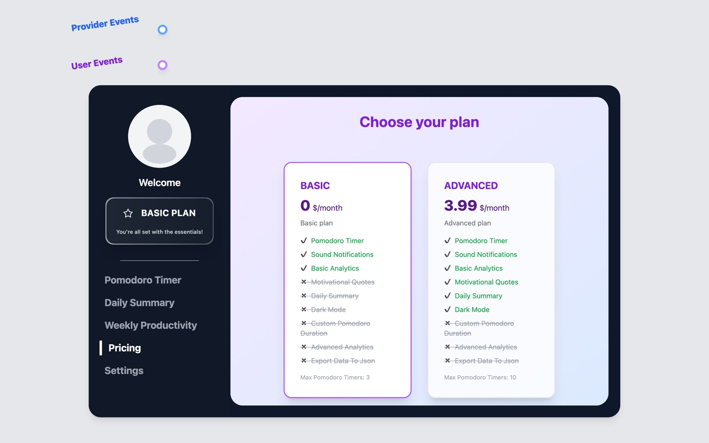

</details>

---

### F1 · Connect the frontend to SPACE

📄 **File:** [`src/App.tsx`](tomatometer/src/App.tsx)

Wrap the whole tree returned by `App` in `<SpaceProvider config={spaceConfig}>`, imported from `space-react-client`. `spaceConfig` already reads the SPACE URL and API key from `.env`.

<details>
<summary><b>💡 Solution</b></summary>

```tsx
// --------------------------------------
// F1 · Connect the frontend to SPACE
// ...
// --------------------------------------
return (
  <SpaceProvider config={spaceConfig}>
    <TimelineProvider>
      <div className="flex flex-col h-screen w-screen">
        <div className="flex flex-1">
          <PageProvider>
            <SettingsContext.Provider value={{ toggles, setToggles }}>
              <SubscriptionProvider>
                <DemoApp />
              </SubscriptionProvider>
            </SettingsContext.Provider>
          </PageProvider>
        </div>
      </div>
    </TimelineProvider>
  </SpaceProvider>
);
```

</details>

**✅ Check**

- [ ] Nothing changes visually, and the app still works. Every SPACE hook and `<Feature>` component can now be used.

---

### F2 · Load the user's pricing token

📄 **File:** [`src/contexts/subscriptionContext/index.tsx`](tomatometer/src/contexts/subscriptionContext/index.tsx) (two places)

1. Get the client with `useSpaceClient()`.
2. In `refresh()`, after the subscription is read, ask SPACE for the user's token with `spaceClient.setUserId(USER_ID)`.

> ⚠️ **Warning:** `useSpaceClient()` only works inside `<SpaceProvider>`. If the page goes blank with *"useSpaceClient must be used within a SpaceProvider"*, finish F1 first.

<details>
<summary><b>💡 Solution</b></summary>

```tsx
// --------------------------------------
// F2 · Load the user's pricing token (part 1 of 2)
// ...
// --------------------------------------
const spaceClient = useSpaceClient();
```

```tsx
// --------------------------------------
// F2 · Load the user's pricing token (part 2 of 2)
// ...
// --------------------------------------
await spaceClient.setUserId(USER_ID);
```

Add `spaceClient` to the dependencies of the `useCallback`, and import the hook:

```tsx
import { useSpaceClient } from 'space-react-client';
```

</details>

<details>
<summary>🔍 Why? When does the token get refreshed?</summary>

`refresh()` already runs when the app loads, when the tab gets the focus back, after every pomodoro and after every plan change, so the token stays up to date.

</details>

**✅ Check**

- [ ] Nothing changes visually and the browser console (F12) shows no errors. You will see the token at work in F4 and F5.

---

### F3 · React to pricing changes

📄 **File:** [`src/contexts/subscriptionContext/index.tsx`](tomatometer/src/contexts/subscriptionContext/index.tsx)

When SPACE activates a new pricing version, it emits a `pricing_actived` event. Add a `useEffect` that:

1. subscribes to it with `spaceClient.on('pricing_actived', …)`,
2. calls `refresh()`,
3. unsubscribes with `spaceClient.off(…)` in its cleanup function.

<details>
<summary><b>💡 Solution</b></summary>

```tsx
// --------------------------------------
// F3 · React to pricing changes
// ...
// --------------------------------------

useEffect(() => {
  const onPricingActivated = () => void refresh();
  spaceClient.on('pricing_actived', onPricingActivated);
  return () => spaceClient.off('pricing_actived', onPricingActivated);
}, [spaceClient, refresh]);
```

</details>

**✅ Check**

- [ ] Nothing visible yet: you will see its effect in Part 4.

---

### B2 · Enforce the daily pomodoro limit on the server

📄 **File:** [`api/routes/pomodoro.ts`](tomatometer/api/routes/pomodoro.ts)

Hiding a button is not enough: the backend must refuse the request too. Before saving a pomodoro session:

1. Evaluate `tomatometer-pomodoroTimer` to check whether the user can start one.
2. If they can, consume one unit of `tomatometer-maxPomodoroTimers`.
3. If they cannot, reply with **403** and do not save the session.

Steps 1 and 2 are a single call to `spaceClient.features.evaluate()`, which answers `{ eval, limit, used, error }`:

```ts
spaceClient.features.evaluate(userId, featureId, { 'tomatometer-maxPomodoroTimers': 1 })
```

<details>
<summary><b>💡 Solution</b></summary>

```ts
// --------------------------------------
// B2 · Enforce the daily pomodoro limit on the server
// ...
// --------------------------------------
if (spaceClient) {
  try {
    const evaluation = await spaceClient.features.evaluate(
      userId,
      'tomatometer-pomodoroTimer',
      { 'tomatometer-maxPomodoroTimers': 1 },
      { server: true }
    );
    if (!evaluation.eval) {
      return res.status(403).json({ error: 'Daily pomodoro limit reached' });
    }
  } catch {
    return res.status(502).json({ error: 'Unable to evaluate the feature in SPACE' });
  }
}
```

</details>

**✅ Check:** you test B2 together with F4, right below.

---

### F4 · Show the timer controls only while pomodoros are left

📄 **File:** [`src/pages/pomodoro-timer/pomodoro-timer.tsx`](tomatometer/src/pages/pomodoro-timer/pomodoro-timer.tsx)

Wrap the timer controls (the `<div>` with *Start*, *Stop* and *Reset*) in `<Feature id="tomatometer-pomodoroTimer">`:

- `<On>`: the controls.
- `<Default>`: the ready-made `<PomodoroLimitReached />`.

<details>
<summary><b>💡 Solution</b></summary>

```tsx
{/* F4 · Show the timer controls only while pomodoros are left today */}
<Feature id="tomatometer-pomodoroTimer">
  <On>
    <div className="flex gap-4">
      <motion.button
        whileTap={{ scale: 0.9 }}
        className="px-6 py-2 rounded-lg bg-purple-600 dark:bg-yellow-400 text-white dark:text-yellow-900 font-bold shadow-lg hover:bg-purple-700 dark:hover:bg-yellow-500 transition"
        onClick={startTimer}
        disabled={isRunning}
      >
        Start
      </motion.button>
      <motion.button
        whileTap={{ scale: 0.9 }}
        className="px-6 py-2 rounded-lg bg-red-500 dark:bg-yellow-600 text-white dark:text-yellow-100 font-bold shadow-lg hover:bg-red-600 dark:hover:bg-yellow-700 transition"
        onClick={stopTimer}
        disabled={!isRunning}
      >
        Stop
      </motion.button>
      <motion.button
        whileTap={{ scale: 0.9 }}
        className="px-6 py-2 rounded-lg bg-gray-400 dark:bg-gray-700 text-white dark:text-yellow-200 font-bold shadow-lg hover:bg-gray-500 dark:hover:bg-gray-600 transition"
        onClick={resetTimer}
      >
        Reset
      </motion.button>
    </div>
  </On>
  <Default>
    <PomodoroLimitReached />
  </Default>
</Feature>
```

Add `Default`, `Feature` and `On` to the imports from `space-react-client`.

</details>

**✅ Check B2 and F4**

1. Open **Pomodoro Timer** and run three pomodoros. To go fast, click **Start**, then **Stop**: it counts as one. After each one, rate your productivity.
2. After the third one, the controls are replaced by the limit screen.
3. The backend enforces it too. Try a fourth request from a terminal:

   ```bash
   curl -s -X POST localhost:5401/api/pomodoro/session -H 'content-type: application/json' -d '{"duration":60}'
   ```

   It is rejected:

   ```text
   {"error":"Daily pomodoro limit reached"}
   ```

<details>
<summary>📸 What you should see</summary>

**A pomodoro running**

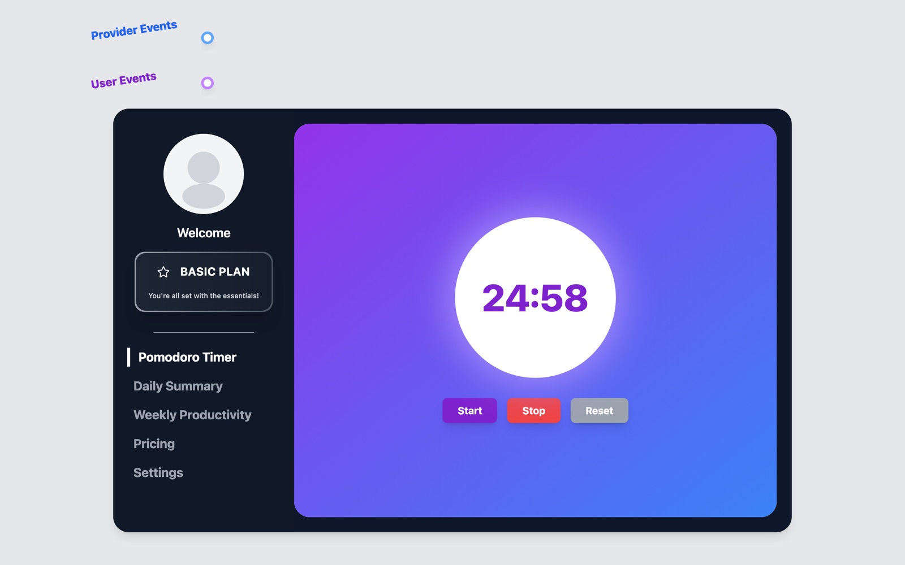

**Rate the pomodoro**

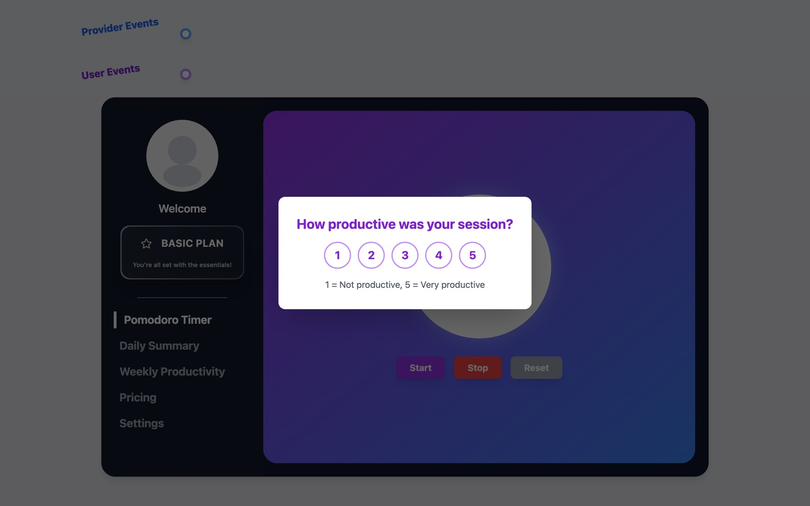

**The daily limit is reached**

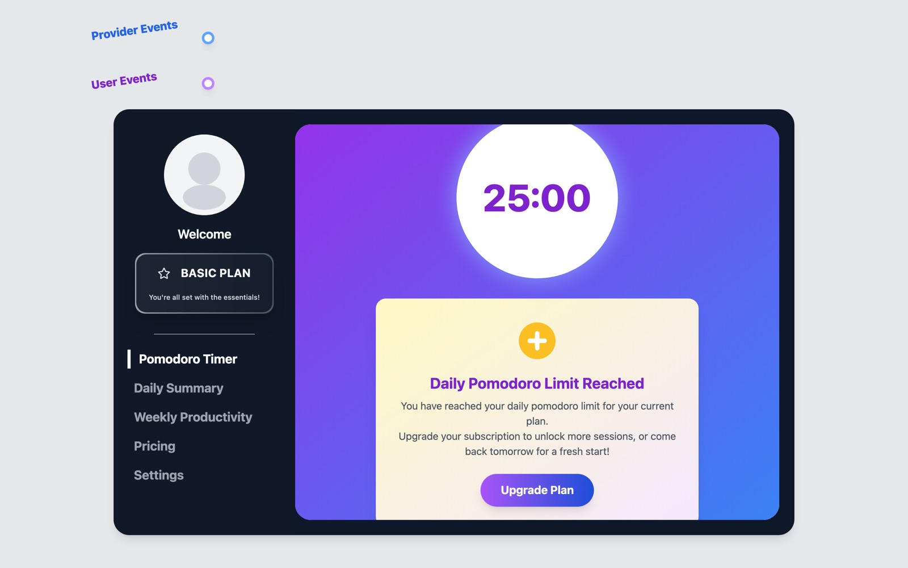

</details>

---

### F5 · Restrict the Daily summary to ADVANCED and PREMIUM

📄 **File:** [`src/pages/daily-summary/daily-summary.tsx`](tomatometer/src/pages/daily-summary/daily-summary.tsx)

Wrap the summary in `<Feature id="tomatometer-dailySummary">`, from `space-react-client`:

- `<On>`: the existing `<DailySummaryList />`.
- `<Default>`: the ready-made `<UpgradeRequired plan="ADVANCED">unlock your daily pomodoro summary!</UpgradeRequired>`.

<details>
<summary><b>💡 Solution</b></summary>

```tsx
import { Default, Feature, On } from 'space-react-client';
import DailySummaryList from '../../components/daily-summary-list';
import { UpgradeRequired } from '../../components/upgrade';

const DailySummaryPage = () => {
  // --------------------------------------
  // F5 · Restrict the Daily summary to the ADVANCED and PREMIUM plans
  // ...
  // --------------------------------------
  return (
    <Feature id="tomatometer-dailySummary">
      <On>
        <DailySummaryList />
      </On>
      <Default>
        <UpgradeRequired plan="ADVANCED">unlock your daily pomodoro summary!</UpgradeRequired>
      </Default>
    </Feature>
  );
};

export default DailySummaryPage;
```

</details>

**✅ Check**

- [ ] On the BASIC plan, the Daily Summary page asks you to upgrade.

<details>
<summary>📸 What you should see</summary>

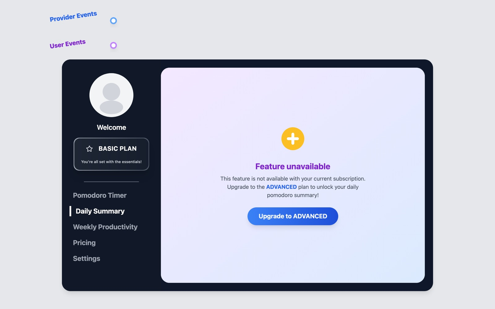

</details>

---

### Upgrade the plan

Go to **Pricing** and click **Select ADVANCED** under the comparison table. The sidebar now shows the ADVANCED plan, the Daily Summary unlocks and the timer is available again (10 pomodoros per day).

<details>
<summary>📸 Screenshots</summary>

**Select the ADVANCED plan**

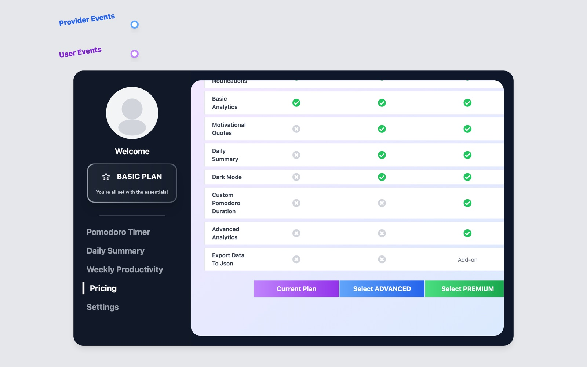

**The Daily Summary on ADVANCED**

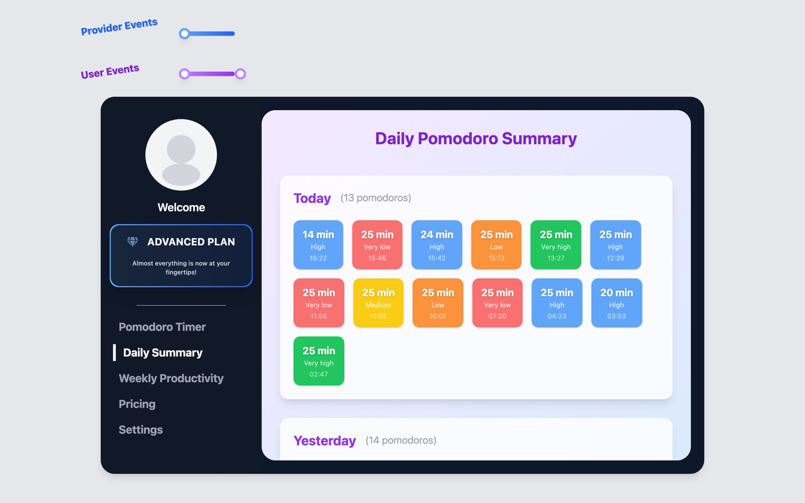

</details>

### ✅ Check

| | Daily Summary | Pomodoro timer | Backend |
|---|---|---|---|
| **BASIC** | 🔒 Locked | 🔒 Locked after 3 pomodoros | Answers 403 |
| **ADVANCED** | 🔓 Unlocked | 10 pomodoros per day | |

</details>

---

## Part 4 · Change the pricing and watch TomatoMeter adapt

<details>
<summary><b>🎯 Goal:</b> give the BASIC plan the <b>Daily Summary</b> and <b>5 pomodoros per day</b> in SPHERE, and watch TomatoMeter adapt <b>without touching the code</b>. <i>(click to open)</i></summary>

### 4.1 Prepare TomatoMeter

1. In TomatoMeter, go back to the **BASIC** plan (Pricing → *Select BASIC*).
2. Open **Daily Summary**: it is locked.
3. Keep this tab open where you can see it.

<details>
<summary>📸 Screenshot</summary>


</details>

### 4.2 Edit the pricing

In SPHERE, open your TomatoMeter pricing and click **New version → Visual editor**. It opens version 1.0.0. Change the BASIC plan:

| BASIC | Before | After |
|---|:---:|:---:|
| Daily Summary | ✘ | ✔ *(click the cell)* |
| Max Pomodoro Timers | 3 timers / day | **5** *(click, type `5`, press **Enter**)* |

Click **Save**.

<details>
<summary>📸 Screenshots</summary>

**New version → Visual editor**

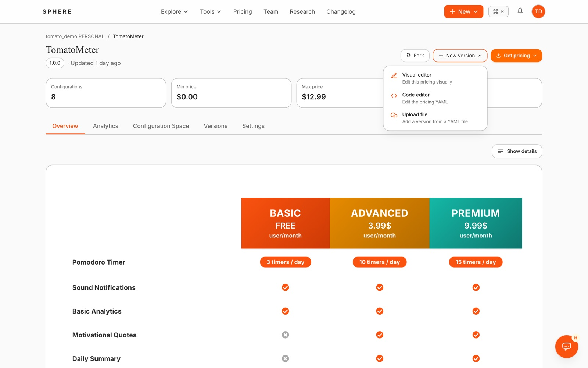

**Editing the BASIC limit**

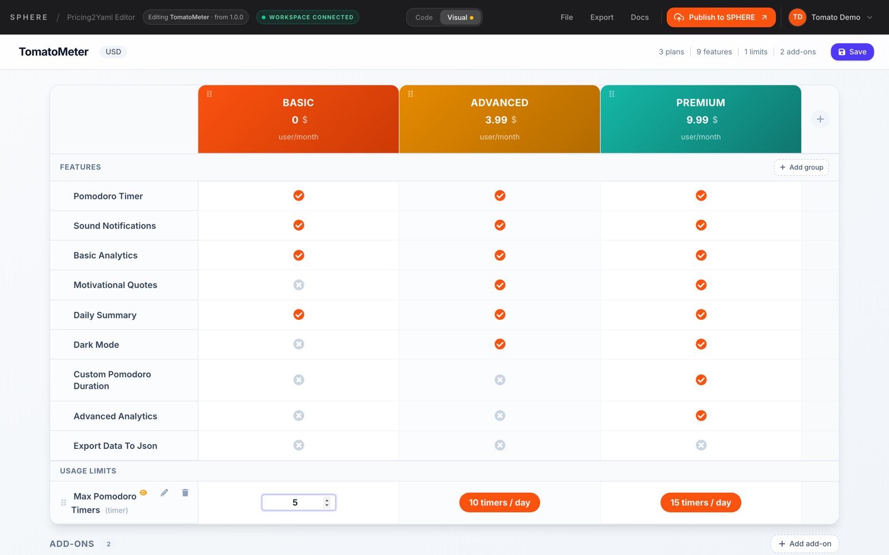

**The BASIC plan, changed and saved**

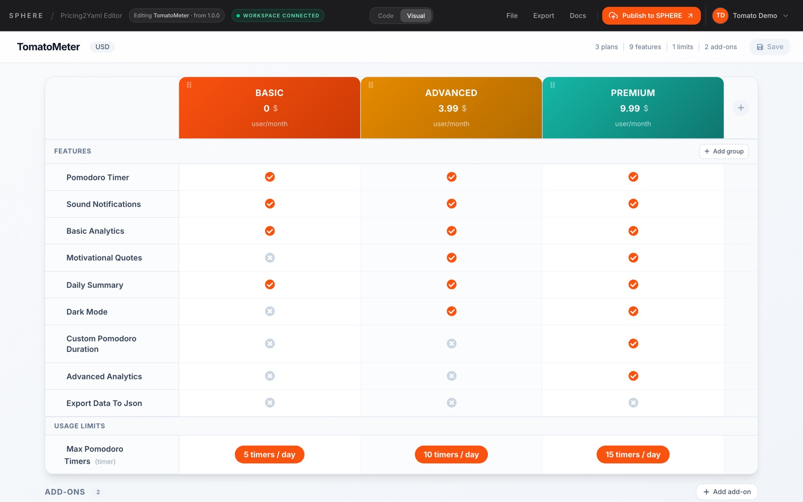

</details>

### 4.3 Publish the new version

Click **Publish to SPHERE**. The dialog selects **New version** of TomatoMeter. Fill in and click **Publish version**:

| Field | Value |
|---|---|
| Visibility | **Public** |
| Version name | `1.1.0` (you did not change the version in the editor, so SPHERE asks you to name it) |
| Release date | Keep the default (now), so that this becomes the latest version |

<details>
<summary>📸 Screenshot</summary>

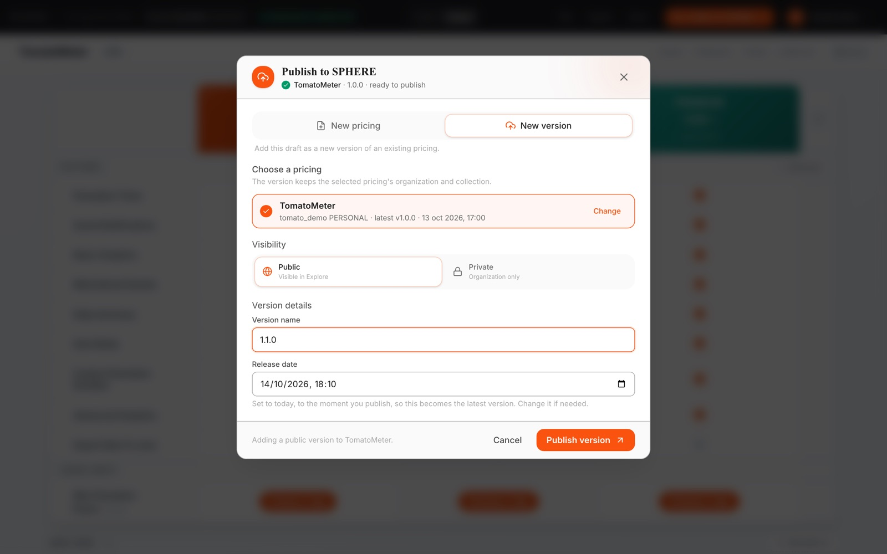

</details>

### 4.4 Watch TomatoMeter

Go back to the TomatoMeter tab and **do not reload it**.

> ❗ **Important:** Within a minute, SPACE detects version 1.1.0, migrates the user's contract and notifies TomatoMeter. The Daily Summary unlocks by itself, and the timeline at the top records a *provider event*.

Then open **Pomodoro Timer**: the controls are back, because BASIC now allows 5 pomodoros per day and you have used 3. Your usage was kept during the migration.

<details>
<summary>🔍 The timer is still locked?</summary>

If you ran more than 5 pomodoros while on ADVANCED, the timer stays locked: that is the new limit at work.

</details>

In SPACE, the **tomatometer** service now applies **v1.1.0**, and its *Latest synchronization* section shows the contracts it migrated.

<details>
<summary>📸 What you should see</summary>

**The Daily Summary unlocks without a reload**

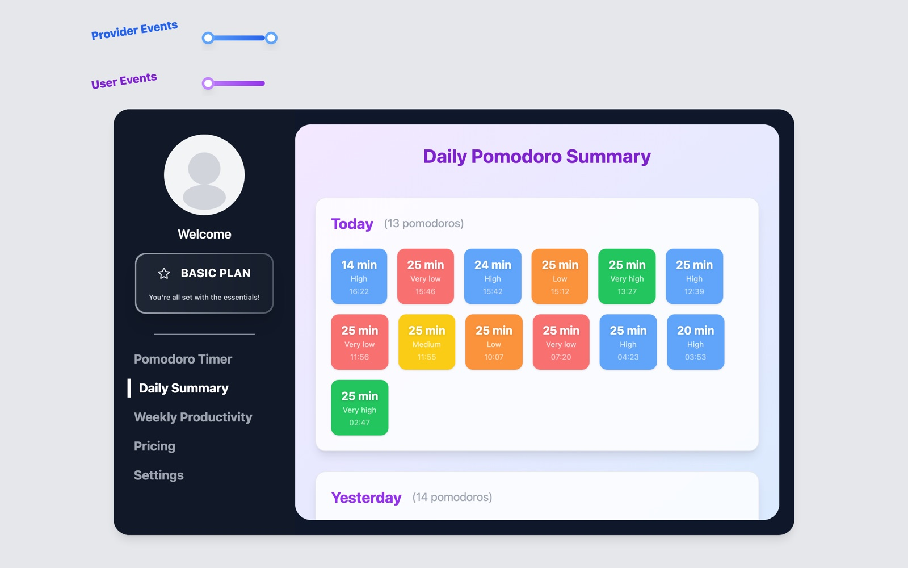

**The timer is available again**

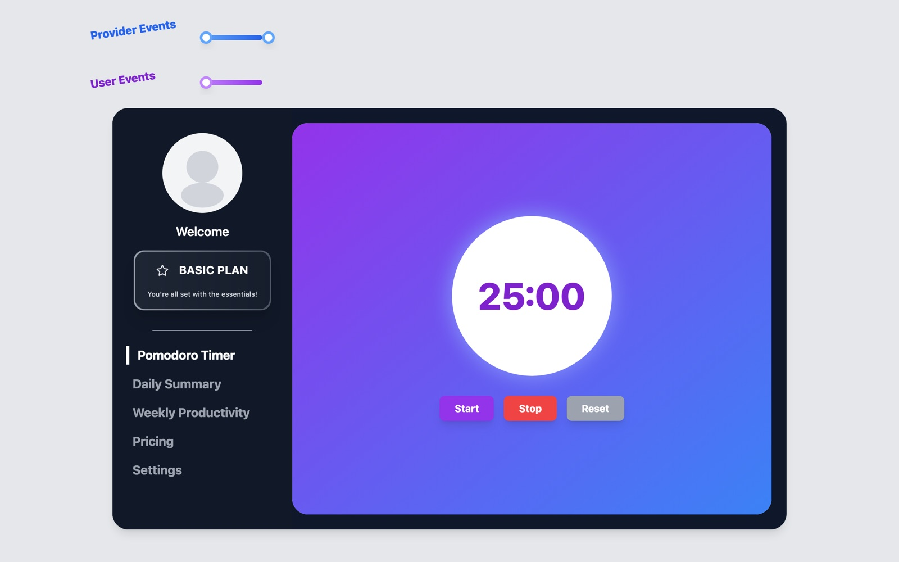

**SPACE applies version 1.1.0**

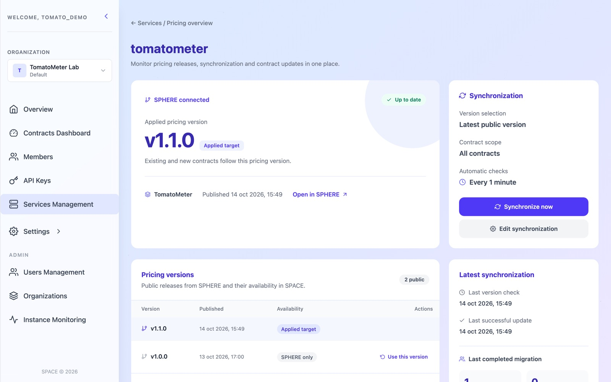

</details>

### ✅ Check

- [ ] SPACE applies v1.1.0.
- [ ] TomatoMeter unlocked the Daily Summary on BASIC without a reload, and allows 5 pomodoros per day.

</details>

---

## Wrap-up

You closed the whole cycle of **pricing-driven self-adaptation**:

| Step | Who | What happened |
|------|-----|---------------|
| **Design** | You, in SPHERE | The pricing became a versioned, public artifact with a permanent link. |
| **Operation** | SPACE | It follows that link, imports every new version, migrates the contracts and notifies the apps. |
| **Enforcement** | SPACE & TomatoMeter | The backend evaluates features and consumes usage in SPACE (B2); the frontend renders from the pricing token (F2, F4, F5), also generated by SPACE. |
| **Adaptation** | TomatoMeter | On `pricing_actived` it renews the token and re-renders (F3): the new pricing took effect without a code change or a redeploy. |

**Keep experimenting:** lower a limit, move `darkMode` to BASIC, or remove a feature from a plan, and publish new versions.

When you are done, stop the lab and delete its data:

```bash
npm run down
```

---

## Troubleshooting

Click on the symptom you see.

#### Setup and pricing (Parts 1–2)

<details>
<summary>The editor shows <i>"Error parsing plan basic"</i></summary>

Every plan needs a `features` entry, even if it is `features: null`.

</details>

<details>
<summary>Changes made in the Visual editor are not published</summary>

Click **Save** in the Visual editor before **Publish to SPHERE**. The orange dot next to *Visual* means there are unsaved changes.

</details>

<details>
<summary>SPACE rejects the permanent link</summary>

Use the link exactly as SPHERE copies it (`http://localhost:5402/p/…`), and make sure the pricing is **public**.

</details>

#### Connecting TomatoMeter (Part 3)

<details>
<summary>The Pricing page says <i>"not connected to SPACE"</i></summary>

Check that `VITE_SPACE_API_KEY` is set in `tutorial/tomatometer/.env` and that B1 is done.

</details>

<details>
<summary>The Pricing page says <i>"Waiting for the TomatoMeter service in SPACE"</i></summary>

TomatoMeter is connected, but the service does not exist in SPACE yet. Go back to [Part 2](#part-2--operate-the-pricing-with-space).

</details>

<details>
<summary>The page goes blank after F2</summary>

`useSpaceClient()` is outside `<SpaceProvider>`: finish [F1](#f1--connect-the-frontend-to-space).

</details>

<details>
<summary>A page that uses <code>&lt;Feature&gt;</code> renders nothing</summary>

The pricing token is not loaded: check [F1](#f1--connect-the-frontend-to-space) and [F2](#f2--load-the-users-pricing-token), and the browser console (F12).

</details>

#### Live adaptation (Part 4)

<details>
<summary>Nothing changes after publishing a new version</summary>

Make sure the new version is **public**, wait up to a minute, and check the service page in SPACE.

</details>

#### Starting over

<details>
<summary>You want the starter code back</summary>

```bash
git checkout -- tutorial/tomatometer
```

</details>

<details>
<summary>You want SPHERE and SPACE back to a known state</summary>

Run `npm run tutorial:1`, `tutorial:2` or `tutorial:3` to reset them to the start of Part 1, 2 or 3. Your code is kept.

</details>
