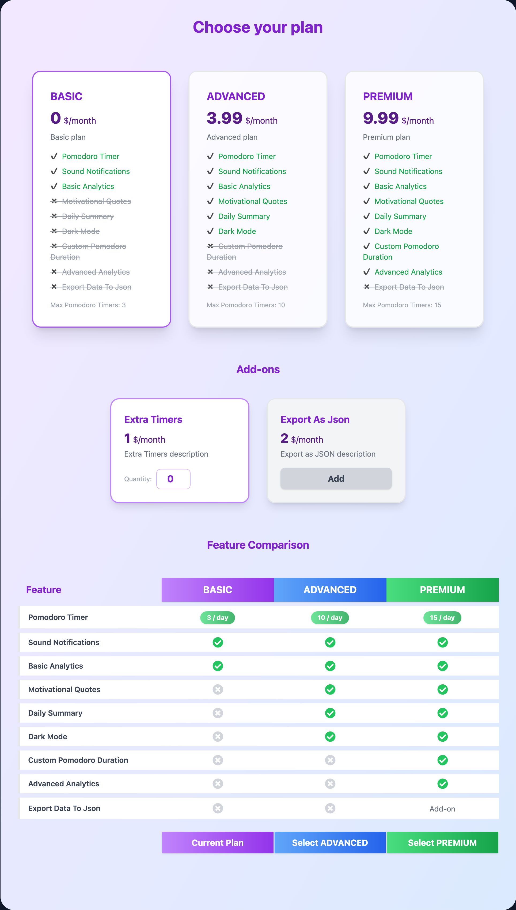

# ICSOC 2026 Tutorial: Pricing-driven Self-adaptation

In this hands-on part of the tutorial you take TomatoMeter, a Pomodoro app that knows nothing about its pricing, and make it **pricing-driven**: you design its pricing in **SPHERE**, operate it at runtime with **SPACE**, and connect TomatoMeter to SPACE so that it enforces the pricing and adapts to every new version you publish, without redeploying.

## Contents

1. [Before you start](#before-you-start)
2. [Checkpoints](#checkpoints)
3. [Step 1 · Design the pricing in SPHERE](#step-1--design-the-pricing-in-sphere)
4. [Step 2 · Operate it with SPACE](#step-2--operate-it-with-space)
5. [Step 3 · Connect TomatoMeter to SPACE](#step-3--connect-tomatometer-to-space)
6. [Step 4 · Change the pricing and watch TomatoMeter adapt](#step-4--change-the-pricing-and-watch-tomatometer-adapt)
7. [Troubleshooting](#troubleshooting)

## Before you start

- [Docker](https://www.docker.com/get-started) (Desktop or Engine) with Docker Compose, running.
- Node.js with npm, to run the lab commands.
- Ports `5401`, `5402` and `5403` free.
- A code editor. TomatoMeter runs inside Docker, so installing its dependencies is optional; run `pnpm install` (or `npm install`) in `tutorial/tomatometer` if you want autocompletion in your editor.

Credentials for SPHERE and SPACE: `tomato_demo` / `tomato-demo`. TomatoMeter needs no login.

| Service | URL |
|---------|-----|
| TomatoMeter (the code you edit) | [http://localhost:5401](http://localhost:5401) |
| SPHERE | [http://localhost:5402](http://localhost:5402) |
| SPACE | [http://localhost:5403](http://localhost:5403) |

## Checkpoints

Every checkpoint is started with a single command from the repository root. They all run the **same TomatoMeter code** (`tutorial/tomatometer`) in development mode: the app reloads as soon as you save a file. What changes is how far SPHERE and SPACE are already set up, so you can jump ahead if you get stuck.

| Command | SPHERE | SPACE | You do |
|---------|--------|-------|--------|
| `npm run tutorial:1` | Only the `tomato_demo` user | Only the `tomato_demo` user | Steps 1, 2, 3 and 4 |
| `npm run tutorial:2` | TomatoMeter pricing published | Only the `tomato_demo` user | Steps 2, 3 and 4 |
| `npm run tutorial:3` | TomatoMeter pricing published | Service linked to SPHERE, API key already in `.env` | Steps 3 and 4 |

> [!NOTE]
> Starting a checkpoint resets SPHERE and SPACE, but **never touches your code** in `tutorial/tomatometer`. The command keeps showing the TomatoMeter logs; press `Ctrl+C` to stop following them (the lab keeps running). Stop everything with `npm run down`.

The first start downloads the images and installs TomatoMeter's dependencies, so it takes a few minutes. Start it before the session if you can.

## Step 1 · Design the pricing in SPHERE

*Starting point: checkpoint 1.*

Log in to SPHERE and create a new pricing for TomatoMeter that reproduces this one:



TomatoMeter's code refers to the pricing by name, so use **exactly these identifiers**:

| Element | Value |
|---------|-------|
| SaaS name | `TomatoMeter` |
| Currency | `USD` |
| Plans | `basic` (0 $/month), `advanced` (3.99 $/month), `premium` (9.99 $/month) |
| Features | `pomodoroTimer`, `soundNotifications`, `basicAnalytics`, `motivationalQuotes`, `dailySummary`, `darkMode`, `customPomodoroDuration`, `advancedAnalytics`, `exportDataToJson` |
| Usage limit | `maxPomodoroTimers`: numeric, **renewable every day**, linked to `pomodoroTimer`. 3 / 10 / 15 per plan |
| Add-on `extraTimers` | 1 $/month, adds **5** `maxPomodoroTimers` per unit (1 to 10 units) |
| Add-on `exportAsJson` | 2 $/month, only for `premium`, enables `exportDataToJson` |

In TomatoMeter, the features you will enforce are:

- `pomodoroTimer` together with `maxPomodoroTimers`: the number of pomodoros per day.
- `dailySummary`: only for ADVANCED and PREMIUM.

For the timer to stop at the limit, `pomodoroTimer` needs an expression that compares the usage with the limit:

```yaml
expression: pricingContext['features']['pomodoroTimer'] && subscriptionContext['maxPomodoroTimers'] < pricingContext['usageLimits']['maxPomodoroTimers']
```

When the pricing is ready, **publish it as a public version**.

## Step 2 · Operate it with SPACE

*Starting point: checkpoint 2 (or your result from step 1).*

1. Log in to SPACE. Your organization, `TomatoMeter Lab`, is already there.
2. Create the **TomatoMeter service linked to the SPHERE pricing**: paste the pricing's permanent link exactly as SPHERE copies it (`http://localhost:5402/p/…`) and choose the `all_last` policy (always serve the latest published version).
3. Copy your organization's **API key** into `tutorial/tomatometer/.env`:

   ```dotenv
   VITE_SPACE_API_KEY=<your key>
   ```

   TomatoMeter picks the change up by itself; there is nothing to restart.

## Step 3 · Connect TomatoMeter to SPACE

*Starting point: checkpoint 3 (or your result from step 2).*

The starter has no SPACE code at all: every feature is open to everyone, and the Pricing page shows *"TomatoMeter is not connected to SPACE"*. Everything else is in place: the screens for locked features, the Pricing page and the creation of the demo user's contract in SPACE. You only write the integration, at the places marked with `TODO` comments:

| TODO | File | What to do |
|------|------|------------|
| **B1** | [api/space/client.ts](tomatometer/api/space/client.ts) | Connect the backend to SPACE with `space-node-client`. |
| **B2** | [api/routes/pomodoro.ts](tomatometer/api/routes/pomodoro.ts) | Before saving a pomodoro, evaluate `tomatometer-pomodoroTimer` while consuming one `tomatometer-maxPomodoroTimers`; reply 403 if it is not allowed. |
| **F1** | [src/App.tsx](tomatometer/src/App.tsx) | Wrap the app in `<SpaceProvider>` from `space-react-client`. |
| **F2** | [src/contexts/subscriptionContext/index.tsx](tomatometer/src/contexts/subscriptionContext/index.tsx) | Load the user's pricing token with `spaceClient.setUserId(...)`. |
| **F3** | [src/contexts/subscriptionContext/index.tsx](tomatometer/src/contexts/subscriptionContext/index.tsx) | Listen to `pricing_actived` and refresh the subscription. |
| **F4** | [src/pages/pomodoro-timer/pomodoro-timer.tsx](tomatometer/src/pages/pomodoro-timer/pomodoro-timer.tsx) | Show the timer controls only while pomodoros are left (`<Feature id="tomatometer-pomodoroTimer">`). |
| **F5** | [src/pages/daily-summary/daily-summary.tsx](tomatometer/src/pages/daily-summary/daily-summary.tsx) | Restrict the Daily summary to ADVANCED and PREMIUM (`<Feature id="tomatometer-dailySummary">`). |

Feature ids follow the pattern `<saas name in lowercase>-<feature name>`, for example `tomatometer-dailySummary`.

**Check your work** at [http://localhost:5401](http://localhost:5401). The demo user starts on the BASIC plan:

- The Pricing page and the sidebar show your pricing and the BASIC plan (B1).
- The Daily Summary page asks you to upgrade (F1, F2, F5).
- After 3 pomodoros, the timer shows *Daily Pomodoro Limit Reached* (B2, F4). To go faster, start a pomodoro and press *Stop*: it counts as one.
- Switching to ADVANCED on the Pricing page unlocks the Daily Summary and raises the limit to 10.

## Step 4 · Change the pricing and watch TomatoMeter adapt

1. Keep TomatoMeter open on the Daily Summary page, on the BASIC plan.
2. In SPHERE, enable `dailySummary` in the `basic` plan (and raise `maxPomodoroTimers` if you like), and publish it as a new version.
3. Within about a minute, SPACE imports the version, migrates the contract and notifies TomatoMeter (F3): the Daily Summary unlocks by itself, with no reload and no redeploy. You can follow the synchronization in the TomatoMeter service in SPACE.

## Solution

[solution/](solution) contains, with the same paths, the starter files that change once every TODO is done. Compare them with your files, or copy them over `tomatometer/` to jump to the end.

## Troubleshooting

- **The Pricing page says "not connected to SPACE".** Check that `VITE_SPACE_API_KEY` is set in `tutorial/tomatometer/.env` and that B1 is done.
- **The Pricing page says "waiting for the TomatoMeter service".** TomatoMeter is connected, but SPACE has no TomatoMeter service yet (step 2). Once it exists, the demo user's contract is created within a few seconds.
- **The gated pages show nothing.** `<Feature>` renders nothing until a pricing token is loaded: check F1 and F2 and the browser console.
- **Logs.** The `npm run tutorial:N` command shows TomatoMeter's logs: `[api]` for the backend, `[web]` for Vite.
- **Start over.** Run the checkpoint command again. To restore the starter code, discard your changes with `git checkout -- tutorial/tomatometer`.
